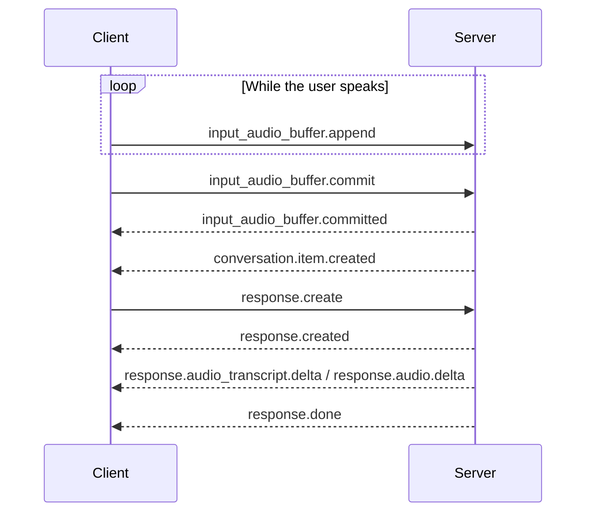
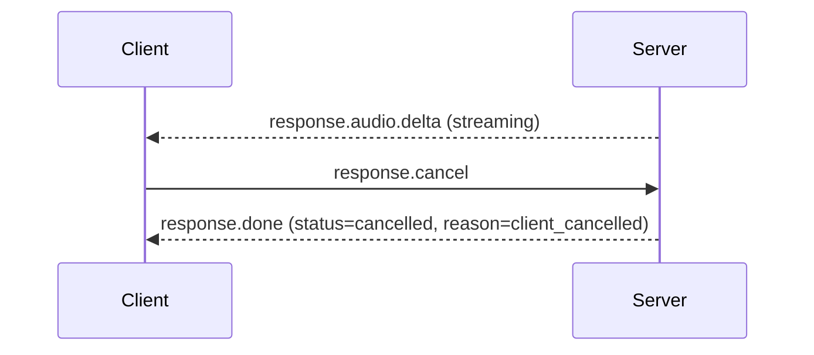

Qwen-Audio Realtime API 通过 WebSocket 提供实时语音对话。客户端通过收发 JSON 事件与服务端交互，支持音频输入、文本输入、语音活动检测（VAD），以及流式音频和文本输出。

**用户指南**：[实时语音对话（Qwen-Audio-Realtime）](https://help.aliyun.com/zh/model-studio/fun-audiochat-realtime)。客户端事件和服务端事件的详细说明请参见[客户端事件](https://help.aliyun.com/zh/model-studio/fun-audiochat-client-events)和[服务端事件](https://help.aliyun.com/zh/model-studio/qwen-audio-realtime-server-events)。

**重要**

阿里云百炼在华北 2（北京）和新加坡地域提供业务空间专属域名，以提升推理性能和稳定性。建议迁移到新域名：

-   华北 2（北京）地域：从 `dashscope.aliyuncs.com` 迁移到 `{WorkspaceId}.cn-beijing.maas.aliyuncs.com`

-   新加坡地域：从 `dashscope-intl.aliyuncs.com` 迁移到 `{WorkspaceId}.ap-southeast-1.maas.aliyuncs.com`

请将 `{WorkspaceId}` 替换为你实际的[业务空间 ID](https://help.aliyun.com/zh/model-studio/obtain-the-app-id-and-workspace-id#d3eb3cd37b7fu)。现有域名仍可继续使用。

## **API 端点**

使用以下 WebSocket URL，并通过 `model` 查询参数指定模型（将 `<model_name>` 替换为实际模型）：

## 华北 2（北京）

`wss://{WorkspaceId}.cn-beijing.maas.aliyuncs.com/api-ws/v1/realtime?model=<model_name>`

发起请求时，请将 `{WorkspaceId}` 替换为你实际的[业务空间 ID](https://help.aliyun.com/zh/model-studio/obtain-the-app-id-and-workspace-id#d3eb3cd37b7fu)。

## 新加坡

`wss://{WorkspaceId}.ap-southeast-1.maas.aliyuncs.com/api-ws/v1/realtime?model=<model_name>`

发起请求时，请将 `{WorkspaceId}` 替换为你实际的[业务空间 ID](https://help.aliyun.com/zh/model-studio/obtain-the-app-id-and-workspace-id#d3eb3cd37b7fu)。

**重要**

URL 必须使用 `wss://`。请在请求头中设置 Authorization，并通过 URL 查询参数 `model` 指定模型。

## **请求头**

在请求头中包含以下信息：

| **参数** | **类型** | **是否必填** | **说明** |
| --- | --- | --- | --- |
| Authorization | string | 是   | 认证 token，格式为 `Bearer <your_api_key>`。将 `<your_api_key>` 替换为你实际的 API key。 |
| user-agent | string | 否   | 客户端标识，用于服务端来源追踪。 |
| X-DashScope-WorkSpace | string | 否   | 阿里云百炼业务空间 ID。 |

**重要**

Authorization 在 WebSocket 握手阶段校验。如果 API key 无效或缺失，握手会以 HTTP 401/403 错误失败。

## **核心概念**

-   **Session（会话）**：每个 WebSocket 连接对应一个会话，会话维护配置和对话上下文。

-   **Conversation Item（对话项）**：对话中的一条消息，按链表顺序组织。

-   **Response（回复）**：一次模型推理产生的输出，包含一个或多个输出项。输出项可以是助手消息，也可以是函数调用。

-   **Function Call（函数调用）**：请求客户端执行某个工具函数的输出项。执行完成后，客户端通过 `function_call_output` 提交结果，再通过 `response.create` 触发下一次推理。

-   **Turn Detection（轮次检测）**：控制何时触发推理。

## **交互模式**

Qwen-Audio Realtime API 支持三种交互模式，通过 `session.update` 事件中的 `turn_detection.type` 参数配置：

| **模式** | **turn\\_detection.type** | **说明** | **适用场景** |
| --- | --- | --- | --- |
| **server\\_vad** | `server_vad` | 服务端 VAD 检测语音边界并自动触发推理。 | 免提对话、语音助手 |
| **smart\\_turn** | `smart_turn` | 结合声学感知与语义理解识别轮次边界，而不是只依赖语音信号。没有语义的声音（例如“嗯”“啊”）不会触发对话轮次，也不会打断模型说话。 | 低延迟的自然对话、高质量打断处理 |
| **push-to-talk** | —（将 `turn_detection` 本身设置为 `null`） | 客户端手动提交音频并触发推理。 | 按键说话、精确控制 |

## **交互流程**

客户端事件和服务端事件的详细说明请参见客户端事件和服务端事件。

### **server\_vad 模式**

服务端对输入音频进行语音活动检测，并在语音结束时自动触发推理。

**启用方式：** 在 `session.update` 事件中将 `turn_detection.type` 设置为 `server_vad`。

## **一个完整的对话轮次**

下图展示了 server\_vad 模式下典型的交互时序：

客户端与服务端按以下顺序交互：

1.  客户端建立 WebSocket 连接，服务端返回 `session.created` 事件。

2.  客户端发送 `session.update` 配置会话参数，服务端返回 `session.updated`。

3.  客户端持续发送 `input_audio_buffer.append` 追加音频数据。

4.  服务端检测到语音开始，返回 `input_audio_buffer.speech_started`，并通过 `conversation.item.input_audio_transcription.delta` 流式返回 ASR 转写增量。

5.  服务端检测到语音结束，返回 `input_audio_buffer.speech_stopped`、`input_audio_buffer.committed` 和 `conversation.item.created`。

6.  服务端自动生成回复，流式返回文本和音频增量（`response.audio_transcript.delta`、`response.audio.delta`），最后返回 `response.done`。

## **用户打断**

如果在模型音频播放期间 VAD 检测到用户说话，服务端会取消当前回复（返回状态为 `cancelled` 的 `response.done`），然后开始新一轮音频输入和回复。下图展示了用户打断的时序：

### **smart\_turn 模式**

结合声学感知与语义理解检测语音结束，过滤附和语、背景音等无语义的声音。无语义的声音会通过 `conversation.item.ambient_audio_transcription.delta` 事件透传，不会触发对话轮次。

**启用方式：** 在 `session.update` 事件中将 `turn_detection.type` 设置为 `smart_turn`。

## **一个完整的对话轮次**

下图展示了 smart\_turn 模式下典型的交互时序：

与 server\_vad 模式的主要区别：

-   没有语义的声音（“嗯”“啊”等）不会触发推理，而是通过 `ambient_audio_transcription` 事件返回。

-   起初被判定为有效的语音可能会被判为无效（`input_audio_buffer.speech_stopped` 返回 `reason=turn_invalid`），此时不会触发推理。

-   在等待用户下一次输入时，客户端可以显式发送 `response.create` 触发推理。

## **用户打断**

打断处理与 server\_vad 模式基本相同。下图展示了用户打断的时序：

## **无效轮次**

起初被判定为有效的语音可能会被判为无效（`input_audio_buffer.speech_stopped` 返回 `reason=turn_invalid`）。此时不会触发推理，客户端应继续发送音频，等待下一个有效的语音轮次。下图展示了无效轮次的时序：

### **说话人增强配置流程**

在 smart\_turn 模式下，如果在第一次 `session.update` 中提供 `voiceprint_audio_urls`，服务端会异步注册声纹（加载目标说话人的音频特征），并通过事件报告进度。声纹注册失败不会阻塞正常对话。

声纹注册按以下顺序进行：

1.  WebSocket 连接建立后，服务端返回 `session.created`。
    客户端随后发送在
    `turn_detection.voiceprint_audio_urls` 中携带声纹音频 URL 的 `session.update`，开始注册。

2.  服务端立即开始异步声纹注册，并在返回 `session.updated` **之前**发送 `voiceprint_audio_list.in_progress` 事件。该事件包含 `item_id`，即本次注册任务的唯一标识。

3.  服务端返回 `session.updated`，确认会话配置已生效。

4.  声纹注册结束后，服务端发送一个终态事件（`item_id` 与第 2 步相同）：

    -   注册成功：`voiceprint_audio_list.completed`。

    -   注册失败：`voiceprint_audio_list.failed`，并带有说明失败原因的 `reason` 字段（例如音频 URL 无法下载）。

**注意**

`voiceprint_audio_urls` 只在**第一次** `session.update` 中生效；后续设置的值会被忽略。

### **push-to-talk 模式**

由客户端手动控制音频提交和推理触发，适用于按键说话场景。

**启用方式：** 在 `session.update` 事件中将 `turn_detection` 设置为 `null`。

## **一个完整的对话轮次**

下图展示了 push-to-talk 模式下典型的交互时序：

客户端与服务端按以下顺序交互：

1.  客户端持续发送 `input_audio_buffer.append` 追加音频数据。

2.  用户说完后，客户端发送 `input_audio_buffer.commit` 提交缓冲区。

3.  客户端发送 `response.create` 手动触发推理。

4.  服务端生成回复，并流式返回文本和音频。

## **用户打断**

客户端发送 `response.cancel` 取消当前回复，服务端返回 `response.done`（状态为 `cancelled`，原因为 `client_cancelled`）。下图展示了用户打断的时序：

## **各模式下的操作约束**

| **操作** | **push-to-talk** | **server\\_vad** | **smart\\_turn** |
| --- | --- | --- | --- |
| session.update | IDLE 状态下所有字段均可修改；非 IDLE 状态下部分字段受限 | IDLE 状态下所有字段均可修改；非 IDLE 状态下部分字段受限 | IDLE 状态下所有字段均可修改；非 IDLE 状态下部分字段受限 |
| input\\_audio\\_buffer.append | 允许  | 允许  | 允许  |
| input\\_audio\\_buffer.commit | 允许  | 忽略  | 忽略  |
| input\\_audio\\_buffer.clear | 允许  | 忽略  | 忽略  |
| response.create | 允许（需先用 `input_audio_buffer.commit` 提交缓冲音频；正在生成回复时不能再次触发） | 没有回复正在生成时允许；正在生成回复时不能再次触发 | 等待用户下一次输入时允许；活跃轮次期间（收到 `input_audio_buffer.speech_started` 到 `response.done` 之间）不能再次触发 |
| response.cancel | 允许（推理期间） | 允许（推理期间） | 允许（推理期间） |
| conversation.item.create/delete/retrieve | 允许  | 允许  | 允许  |

**注意**

`turn_detection` 和 `input_audio_format` 只能在首次发送音频之前（IDLE 状态下）修改。

## **错误处理**

| **类型** | **行为** | **示例** |
| --- | --- | --- |
| 客户端错误（`invalid_request_error`） | 连接保持打开；仅发送通知 | 参数无效、当前状态不允许、item\\_id 重复 |
| 服务端错误（`server_error`） | 连接被终止 | LLM 连接失败、存储失败 |
