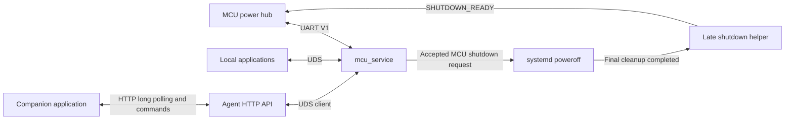

# MCU Service 实现方案

设计记录。已实现的接口和烧录后验证脚本参见 [MCU Service](mcu-service.md)；硬件关机验收仍需在开发板上测试。

状态：历史设计，基于 2026-10-19 检查的各仓库内容。API、LED 扩展、守护进程、关机集成和离线测试现已实现。
下文使用将来时态的章节保留了最初的设计要求；当前接口和部署方式请以链接的服务页面为准。物理关机验收仍未完成。

用生产级 MCU 服务替换 `aico-mcu-event.service` 背后的诊断实现。它将处理 RV 的启动/关机握手，
通过长轮询转发唤醒事件，并向应用提供类型化的定时器、状态、电池和 LED 操作。

## 来源与当前行为

| 源码快照 | 相关实现或规范 |
| --- | --- |
| `aiden-design`，`7ee65bc` | `MCU 与 RV1106 电源与通信接口方案/MCU 与 RV1106 电源与通信接口方案.md`，尤其是 6.1–6.5 节 |
| `aiden-mcu`，`1bf1776` | `docs/protocol-v1.md`、`docs/application.md`、`include/aiden/v1.h`、`src/protocol/v1.c`、`src/app.c`、`src/power/supervisor.c` |
| 本仓库检出，`5d3a447d` | 诊断用 UART 服务（记录版本中的 `overlay-debian/usr/lib/aiden/aiden-mcu-event`）、[systemd 单元](../../overlay-debian/etc/systemd/system/aico-mcu-event.service)、协议测试（记录版本中的 `tests/test_mcu_event_service.py`）以及[部署说明](../01-getting-started/deployment.md) |
| 现有应用集成 | [BLE 服务](ble-service.md)、`src/agent/internal/ble/{event_store,uds,client}.go`，以及 `src/agent/internal/agent/server.go` 中的 Agent HTTP 路由 |

设计文档定义线路语义；MCU 源码提供实现约束，例如负载上限、序列号复用和定时器持久化。

现有的 Python 服务以 115200 8N1 独占 `/dev/ttyS5`。它发送 `RV_READY`，以固定的 READY 状态和版本 0.1.0
应答 `GET_STATE`，并记录事件。有效的 `SHUTDOWN_REQUEST` 会收到 DENIED。它没有应用 socket、出站请求引擎、
定时器/电池 API，也没有生产级的关机路径。

替换后必须保留以下几点区分：

- `GET_STATE`（`0x01`）是 **MCU → RV**。其中的版本和状态描述的是 RV 服务。MCU 会显式拒绝由 RV 发起的
  `GET_STATE`；V1 没有读取 MCU 固件版本或完整电源监控器状态的命令。
- `WAKEUP`（`0x07`）本身已包含唤醒来源。不存在唤醒来源查询。来源 `0x06` 表示 ASR；它与命令 `0x06`
  （即 `RV_READY`）无关。
- MCU 定时器是由 SysTick 维护的单个相对时间、一次性定时器。在 MCU 保持供电时它能在 RV 断电后保留，
  但 MCU 复位后会丢失。把来源称为 RTC/TIMER 并不意味着它是基于 RTC 的闹钟。
- LED 输出位于 PF0（红）和 PF1（白），由 MCU 自主策略控制。V1 目前只分配到 `0x0A` 为止的命令；
  LED 请求需要在设计和 MCU 仓库中进行增量式的协议变更。
- BLE 的 `events_since` 目前会立即返回。其游标/generation 模型可以复用，但需要为 MCU 增加阻塞等待和取消功能。

## 架构与所有权



在 `src/agent/cmd/mcu_service/` 实现一个专用的 Go 可执行文件，由 `src/agent/internal/mcu/` 提供支持。
沿用 BLE 服务的打包方式和通用的 [12 字节 UDS 信封](../07-protocols/uds-protocol.md)，并在
`/run/mcu_service/mcu_service.sock` 新建 socket。提供类型化的 Go 客户端方法，并为其他语言的本地应用记录信封格式。
Agent 为配套应用提供一个轻量的 HTTP 适配层；本地应用可以直接使用 UDS。

保留已安装的单元名称 **`aico-mcu-event.service`**，并将其 `ExecStart` 改为 `/usr/lib/aico/mcu_service`。
废弃 Python 日志程序及其由软件包管理的副本。不要安装第二个争抢 ttyS5 的服务。保留 journal 日志记录以及现有的
`aico.target` 激活入口。

守护进程在正常运行期间独占 UART，使用建议锁，并在支持的情况下使用终端独占模式。UART 接收、帧发送和请求调度与 API 等待相互独立。
来自 MCU 的请求和关机响应优先于应用查询。后期关机辅助程序只有在守护进程退出并放弃所有权之后才会打开 UART。

这个小型独立守护进程以 root 身份运行，其应用 socket 属于 `root:aico`，权限为 `0660`。这是相对于日志程序使用
`aico` 用户的一项明确变更：守护进程必须安排系统关机并创建受保护的关机标记。API 只暴露类型化操作；
不会向应用暴露原始 UART、任意命令、`RV_READY`、`SHUTDOWN_READY` 或关机操作。

在 UART 设备存在之后启动该服务，与 Agent 启动、网络、BLE、模型和应用配置无关。在宣布 READY 之前，
先初始化事件存储、请求分发和关机协调器。Agent 使用可配置的 `AICO_MCU_SERVICE_SOCKET`，并在服务不可用时重新连接；
在没有 MCU 硬件的桌面环境中仍然可以运行。

## UART 传输与恢复

保留版本 1、小端序序列化，以及从 VER 到 PAYLOAD 的 CRC-16/CCITT-FALSE。使用 MCU 的 64 字节负载上限和
100 ms 的不完整帧过期时间。遇到垃圾数据、CRC 错误、无效类型/版本或超长长度时重新同步，同时不丢弃紧随其后的有效帧。
在使用数据之前，校验确切的命令长度、保留字段、枚举范围和响应 STATUS。

同一时间只发送一个出站请求，并使用有界的应用队列。同时按 SEQ 和 CMD 匹配响应。以 100 ms 的间隔重发相同的请求帧，
初次发送后最多重试三次；在 400 ms 时终止。忽略未经请求的响应和迟到的响应。排队延迟有单独的截止时间；
过载时返回 BUSY，而不是让内存无限增长。

对入站请求镜像 MCU 的重复请求语义：保留 16 个条目，每个保留两秒，在产生副作用之前先占位；SEQ/CMD/负载完全相同时重放原始响应，
负载冲突时返回 INVALID，有效缓存已满时返回 BUSY。响应入队的重试受 MCU 100 ms 预算的限制。
维护一个独立的关机锁存，使之后使用新 SEQ 的请求，或在缓存过期后到达的请求，都无法发起第二次关机事务。

出站请求的序列号在首次尝试后隔离 2.4 秒。守护进程启动/重新打开时，先让之前的 UART 所有者静默，并在发送新的出站请求之前强制两秒的保护期；
随机的初始 SEQ 是额外的预防措施。排空过期的响应，但继续解析有效事件并应答 MCU 请求。初始化期间，
`GET_STATE` 返回 BOOTING，除非有待恢复的关机事务。不要仅仅因为还没有应用连接就丢弃有效的唤醒事件。

初始化完成后，发送带 `01 00 00 00` 的 `RV_READY`。以六个字节应答 MCU 的 `GET_STATE`：SUCCESS、协议版本、
RV 服务语义化版本（三个字节）以及 RV 状态。该响应中的 READY 为 `0x02`，而 READY 事件负载的第一个字节为 `0x01`。
MCU 的轮询可以弥补丢失的 READY 事件；恢复或普通启动时不要合成 WAKEUP。

使用最近一次有效接收时间、最近一次完成的请求和错误计数器来报告链路健康状况。仅凭 UART 打开成功或 READY 事件已发送，
并不能证明 MCU 可用。通信丢失永远不会请求 Linux 关机。V1 没有会话标识符，因此无法保证在对端复位后仍恰好一次投递，
也无法明确检测到每一次 MCU 复位。

## 启动与关机行为

RV 协议状态包括 BOOTING（`0x01`）、READY（`0x02`）和 SHUTTING_DOWN（`0x03`）。它们描述的是通信/生命周期的就绪状态，
而不是每个应用是否都已加载完成。MCU 负责开关竞态、电源轨、已排队的重启决策以及强制的断电间隔；RV 不会切换 RV_HOLD。

对于有效的 MCU `SHUTDOWN_REQUEST`（`0x09`，负载 `01 00 00 00`）：

1. 占位重复响应状态，锁存关机并停止接受应用的变更操作。在确认接受之前，原子地记录一个属于 root、
   仅对本次启动有效的意图，这样即使在 ACK 之后崩溃也不会丢失该事务。这部分有界的工作放在 tmpfs 上，不涉及 userdata I/O。
2. 将该意图存储在 `/run/aico-mcu-poweroff/` 下的一个单独目录中。该目录必须在守护进程正常停止/RuntimeDirectory
   清理后依然保留。存储首次接收时间和事务标识；守护进程重启后必须恢复该意图，并且在其待处理期间绝不能再次宣布 READY。
   在 100 ms 内通过优先发送通路缓存并发送 SUCCESS。重复请求会重放该响应，而不会重新开始工作或重置截止时间。
   如果意图设置失败，则返回 INTERNAL_ERROR 并尝试紧急有序清理；MCU 的截止时间仍然有效。
3. 异步请求固定的 systemd 关机操作。不要让 UART 分发阻塞在进程清理或同步的 systemctl 调用上。
   调度失败保持可见，并在原始截止时间内重试；它们不会取消 MCU 的强制断电计时器。
4. 在守护进程仍然存活期间，以 SHUTTING_DOWN 应答 `GET_STATE`，拒绝新的硬件变更操作，并取消 API 等待者。
   由 systemd 停止写入方、刷新应用状态、停用 swap 并完成文件系统卸载。
5. 安装在 `/usr/lib/systemd/system-shutdown/` 中的一个静态链接的小型辅助程序会校验 `poweroff` 操作和本次启动的意图。
   它在最终关机阶段、常规服务都已退出之后运行。它会检查相关的持久化文件系统已卸载或为只读，且 swap 未激活；
   检查失败时扣留 READY。它获取 UART 所有权，写入 `SHUTDOWN_READY`（`0x0A`，`01 00 00 00`），
   并在有限的截止时间内等待发送完成后退出。

该辅助程序不依赖 Agent、D-Bus、Python、可写的 userdata 或网络。在这个后期阶段，其可执行文件和意图标记必须仍然可读；
请在随附的 Debian/systemd 镜像上验证这一点。由于钩子可能并行运行，请审查其他关机钩子：在该辅助程序发出完成信号之后，
任何钩子都不得执行关键写入。常规的守护进程 `ExecStop` 和单纯的 `sync` 不足以证明断电是安全的。

普通的服务停止、软件包升级、守护进程崩溃和 Linux 重启永远不会发出 SHUTDOWN_READY，也不会创建 MCU 关机意图。
尤其不要把每个 SIGTERM/重启都映射为线路上的 SHUTTING_DOWN：MCU 会把该状态解释为允许进入其有时限的断电流程。
首个实现只协调由 MCU 请求的关机；将来由应用请求的关机必须另行定义其 MCU 目标/重启语义。

### 启用生产关机之前必须解决的截止时间问题

设计允许**从首次关机请求起 30 秒**，无论是 SUCCESS、DENIED、BUSY 还是没有 ACK。当前的 MCU 实际上是在其监控器进入
SHUTTING_DOWN 时（早于 UART 入队/投递）开始计时的。收到 SHUTDOWN_READY 后，它会等待 **75 ms** 再断电。
ACK 只确认已收到请求。

该实现将 `aico-agent.service` 缩短为 `TimeoutStopSec=10s`，将 `aico-swap.service` 缩短为 5s；
若干依赖服务仍各自为 10s。它们的关机依赖链可能使这些延迟叠加，因此仅凭这些设置并不能证明整个路径满足预算。

设定一个经过测量的目标：从 MCU 首次请求到 SHUTDOWN_READY 完全发送不超过 25 秒，保留至少五秒的余量。
将应用取消、依赖服务停止、swapoff、文件系统刷新/卸载以及最终辅助程序作为一条完整的关键路径来做预算。
初始工程目标大致为：应用清理约 10 秒，依赖资源约 5 秒，最终存储清理约 5 秒；再根据这条路径推导各个单元的时限和取消逻辑的修改。
RV 的接收时间戳可能因队列/重试/链路延迟而低估 MCU 侧实际经过的时间；开发板验收必须从 MCU 的状态转换开始计时。

仅缩短 systemd 超时并不能证明数据安全。请测试正在进行的写入、swap 压力、备份/恢复以及 OTA 活动。
如果完整路径无法满足固定的截止时间，请在启用生产握手之前同时更新设计和 MCU 超时。永远不要为了掩盖缓慢的清理而提前发送 READY。
存储故障时仍可能触发 MCU 的强制断电；请在验证和诊断中明确体现这一结果。

## 应用 API

建议的 UDS 操作及其对应的 Agent HTTP 接口：

| UDS 操作 | HTTP 方法与路径 | 含义 |
| --- | --- | --- |
| `get_state` | `GET /api/mcu/state` | 本地 RV 状态/版本、服务 generation、UART 健康状况、最近的 RK628 状态以及 LED 支持情况 |
| `get_battery` | `GET /api/mcu/battery` | 发出 MCU 命令 `0x02` 并对其响应进行归一化 |
| `get_wakeup_timer` | `GET /api/mcu/wakeup-timer` | 针对定时器 ID 0 发出 `0x04` |
| `set_wakeup_timer` | `PUT /api/mcu/wakeup-timer` | 发出带启用延迟的 `0x03` |
| `cancel_wakeup_timer` | `DELETE /api/mcu/wakeup-timer` | 发出 `0x05`；返回已确认的非激活状态 |
| `events_since` | `GET /api/mcu/events` | 基于游标的事件历史，可选长轮询 |
| `get_led` | `GET /api/mcu/leds/{red\|white}` | 读取 LED 配置和实际输出（需 MCU 扩展） |
| `set_led` | `PUT /api/mcu/leds/{red\|white}` | 选择 auto/off/on/blink，并带有有时限的覆盖租约 |

HTTP 适配层沿用现有 BLE 控制对 USB ECM 或回环地址的限制。它将请求取消传递给 UDS，并返回 `Cache-Control:
no-store`。它不会把事件消费到单独的 Agent 队列中。因此，本地应用和配套应用看到的是相同的 generation 和游标空间，
即使 Agent 重启也是如此。

返回具名错误，并在存在时附带原始的 `mcu_status`。区分无效参数（HTTP 400）、被拒绝的操作（403）、
不支持的可选 LED 命令（501）、临时的 BUSY/NOT_READY/不可用状态（503）、传输截止超时（504）、
格式错误的 MCU 应答（502）以及内部故障（500）。对于变更操作，generation 不匹配或以不同参数复用同一 ID 返回 409。
事件 generation 重置使用带 `reset_required` 的 HTTP 200 分页。长轮询正常超时返回 HTTP 200 和空事件数组。
拒绝非空的 UDS 二进制负载；在分配内存或解码之前，将 JSON 请求限制为 16 KiB，响应限制为 256 KiB。

变更操作需要客户端生成的 `request_id` 和当前服务的 `generation`。在一个有界的（512 条、10 分钟）幂等缓存中保留结果和进行中的记录；
当所有条目都有效时拒绝新的变更。以相同的操作和参数复用 ID 会返回其原始结果；冲突的复用会被拒绝。
在访问 UART 之前拒绝过期的 generation。这可以防止 HTTP 重试在守护进程重启后悄悄地重新启动定时器。
发送之后发生的传输超时属于**结果未知**：保留该结果，查询当前状态进行核对，并要求有意地使用新的请求 ID 发起另一次变更。
缓存在过期后不提供去重保证：客户端必须进行核对，而不是重放已过期的 ID。它们不得自动以新的 UART 请求重试变更。
HTTP 在变更请求体中携带这些字段，包括 DELETE；客户端封装隐藏了这一传输细节。

### WAKEUP 长轮询

参照 BLE，使用一个有界的内存环形缓冲区（初始为 512 个事件），事件 ID 为单调递增的十进制字符串，并带有一个随机的守护进程 generation。
事件存储的生命周期独立于 Agent 和所有消费者。

```json
{"op":"events_since","since":"41","generation":"g1","limit":50,"wait_ms":25000}
```

```json
{
  "status": "OK",
  "generation": "g1",
  "events": [
    {
      "id": "42",
      "type": "wakeup",
      "source": "asr",
      "source_code": 6,
      "uart_seq": 37,
      "received_at": "2026-10-19T08:00:00Z"
    }
  ],
  "next_id": "42",
  "oldest_id": "1",
  "last_id": "42",
  "reset_required": false,
  "truncated": false
}
```

对应的 HTTP 查询为 `/api/mcu/events?since=41&generation=g1&limit=50&wait_ms=25000`。
明确定义以下行为：

- `since` 是不包含边界的。以 `since=0` 且不带 generation 开始，读取保留的历史。后续读取带上返回的 generation。
  `limit` 默认为 50，接受 1–100；`wait_ms` 接受 0–25000。UDS 默认立即读取；HTTP 默认 25000 ms。
- 有可用事件时立即返回。否则等待新事件追加、超时、取消或关闭。超时返回 `events: []` 并保留游标。
  检查环形缓冲区和注册唤醒通知必须是原子操作，这样在两者之间到达的事件不会被遗漏。
- `next_id` 是实际返回的最后一个事件；空分页时为输入的游标。`last_id` 是环形缓冲区的最高水位。
  客户端前进到 `next_id`，分页受限时绝不能前进到 `last_id`。
- generation 不匹配时返回 `reset_required=true`，不含事件，也不等待；此时不带 generation 从零重试。
  非零游标必须带 generation。超前于历史的游标同样需要重置。已被淘汰的游标会返回保留的事件并带 `truncated=true`；
  如果更早的事件已被淘汰，从零开始的读取也会报告截断。
- 各读者拥有独立的游标；读取永远不会替其他读者消费事件。应用按 `(generation,
  id)` 对已处理的操作去重。UART SEQ 会回绕，只用于诊断，不是事件 ID 或去重键。
- 限制活动连接和等待者的数量，初始为 64 个连接和 32 个长轮询等待者，并预留控制容量。等待永远不持有 UART 或状态锁。
  服务关闭时取消活动的等待并关闭连接。等待使用专用的客户端连接，以保证普通命令仍能及时响应。
- BLE 的 10 秒 UDS 服务端截止时间和 5 秒默认客户端截止时间不能照搬。请使用有界的请求读取截止时间，
  然后将响应截止时间设为 `wait_ms` 加上传输余量（五秒），并以调用方的截止时间为上限。通过关闭连接传播取消；
  在 HTTP 及其客户端超时中实现相同的行为。

对于 WAKEUP，要求负载恰好为四个字节，其中三个保留字节为零。将来源 1–6 映射为 `external_power`、`power_switch`、
`touch_key`、`rtc_timer`、`other`、`asr`。未知值保留为 `source: "unknown"` 加 `source_code`；
它们不会选择任何已知的应用操作。格式错误的事件只会增加诊断计数，永远不会进入应用唤醒流。不要对 WAKEUP 发送 ACK、
发起来源查询，也不要为正常的开关启动编造唤醒事件。

将 `RK628_PLUGIN_DET_CHANGED` 作为单独的事件类型保留在同一个环形缓冲区中，并缓存其最新的有效状态供 `get_state` 使用。
校验长度、保留字节以及低电平有效的插入状态/原始电平的一致性。即使只处理 WAKEUP，消费者也要越过所有类型的事件推进游标。

触摸、ASR 和定时器唤醒的含义由应用代码决定。Agent 的语音消费者必须用来自本地 UDS 长轮询的
`WAKEUP(source=asr, source_code=6)` 取代直接的 GPIO32/GPIO33 激活，同时保留 STT、追问、实时和打断行为。
其他事件来源不得自动激活语音。快速捕获的 GPIO 保持独立。在同一次启动内跨语音重新加载和 Agent 重启保留消费者游标，
处理重连/generation 重置/分页，停止时取消等待，并跳过过时的历史。服务本身不会启动语音录制，也不会把 MCU 唤醒与用于唤醒手机的
BLE 通知混为一谈。已实现的消费者策略及其投递限制参见 [Agent 语音激活](./mcu-service.md#agent-语音激活)。

只要事件仍在该守护进程的环形缓冲区中，投递就是可重放的。它不是持久化的，也不是恰好一次的：MCU 会将尚未发送的触发合并为最新的来源，
UART EVENT 没有 ACK/重试，守护进程重启会清除历史。API 会让已知的本地缺口可见，但无法恢复在 UART 接收之前就已丢失的唤醒。

### 定时器操作

将 `delay_s` 暴露为 1–604800 之间的整数；在类型化的应用客户端中隐藏固定的定时器 ID 0。SET 编码为
`00 01 <delay_s:LE32>`，GET/CANCEL 编码为 `00`。应用取消使用 CANCEL；底层编解码器仍会校验 `enable=0` 的 SET，
此时 MCU 会忽略延迟值。

三种响应都是八个字节：STATUS、ID、active、保留字节、剩余秒数 LE32。要求 ID 为零、active 为 0/1、保留字节为零；
返回 MCU 已确认的 `{timer_id: 0, active, remaining_s}`。剩余时间在 MCU 固件中向上取整。不要把仅含状态的错误当成定时器未激活。

只有一个共享定时器，而不是每个客户端一个。变更串行执行；最近一次被接受的 SET 会替换之前的配置。
SET 和 CANCEL 的重试都要带上 `request_id`/`generation`。MCU 的重复请求重放不得重置倒计时。
到期会以来源 4 的 WAKEUP 呈现，并且可能在 RV 已处于 READY 时发生，无需电源循环。MCU 复位后不要自动恢复旧定时器，
也不要假装它能在 MCU 断电后保留。

### 状态与电池操作

`get_state` 读取与面向 MCU 的 GET_STATE 响应相同的本地 RV 生命周期状态，外加守护进程健康状况和事件 generation。
字段命名为 `rv_state`、`rv_service_version`、`protocol_version`、`uart_connected`、`last_rx_at` 和
`led_support`；说明 UART 打开状态与对端健康状况在语义上的区别。不要向 MCU 发出命令 `0x01`，也不要把 RV 版本标注为 MCU 版本。
如果以后应用需要 MCU 监控器状态/版本，请分配一个独立的命令，并在共享协议中定义其响应。

`get_battery` 发送一个空的命令 `0x02` 请求。其成功响应为**六个字节**：STATUS、百分比、电压 LE16、充电状态、保留字节。
将百分比 `0xFF` 和毫伏值 `0xFFFF` 映射为 JSON `null`，并保留原始字段用于诊断。将充电状态 0–3 映射为
not_charging、charging、full 和 absent_or_unknown；不要从未知数据推断出零电量。

提供查询的接收时间，但不要将其标注为硬件采样时间。MCU 大约每五秒刷新一次快照，当最近一次完整快照超过 15 秒时报告未知字段。
V1 不提供采样时长。应用的显式查询应读取 MCU 状态；首个实现不额外增加持久化的电池缓存。

## 建议的 LED 协议扩展

在发布支持之前，在设计文档、其 MCU 参考副本、`docs/protocol-v1.md` 以及两端实现中保留以下目前尚未分配的 ID。
这些只是提议，并不是所检查的 MCU 镜像已支持的命令。

| CMD | 方向 | 请求 | 成功响应 |
| --- | --- | --- | --- |
| `0x0B SET_LED` | RV → MCU REQ | 八个字节：led_id、mode、on_ms LE16、off_ms LE16、lease_s LE16 | 与 GET_LED 相同的 12 字节状态 |
| `0x0C GET_LED` | RV → MCU REQ | 一个字节：led_id | STATUS、led_id、requested_mode、effective_mode、on_ms LE16、off_ms LE16、remaining_s LE16、output_level、override_reason |

LED ID 中红灯为 `0`、白灯为 `1`；逻辑输出 1 表示点亮。模式中 auto 为 `0`、off 为 `1`、on 为 `2`、blink 为 `3`。
On/off 是逻辑模式，不是亮度或 PWM。该开发板只有两个分立 LED，因此 RGB 和调光不在此扩展范围内。

校验与行为：

- Auto 要求时序和租期字段均为零，并释放覆盖。Off/on 要求 on/off 时长为零，租期为 1–3600 秒。
  Blink 要求 on/off 时长各为 20–60000 ms，租期为 1–3600 秒。其他所有值都以仅含 STATUS 的 INVALID 拒绝。
- SET 会启动/替换该 LED 的租约，并将闪烁相位重置为 ON。重复请求会返回最初缓存的响应，不会延长租约或重启相位。
  GET 报告向上取整后的剩余租期。
- 租约使用 MCU 单调时间，到期后恢复为 auto。MCU 复位以及 RV 进入关机/断电状态时清除覆盖；下次启动时不会恢复。
  在被更高优先级的指示屏蔽期间，租约仍会继续计时。
- 初始的 150 ms 启动指示以及红灯的低电量/充电策略优先于应用覆盖。在其他状态下，应用覆盖优先于现有的红灯运行指示和白灯心跳。
  Auto 始终使用现有的 MCU 策略；不要从无关的代码路径改写 GPIO。
- `effective_mode=auto` 表示自主模式。返回实际的瞬时 `output_level` 和 `override_reason`：应用 `0`、auto `1`、
  启动 `2`、low_battery `3`、充电 `4`、shutdown_or_off `5`。被屏蔽期间，请求的模式/时序仍然可见。
  租约释放或到期后，请求的模式为 auto，时序/剩余字段为零。
- 只有在 MCU 认为 RV 处于 READY 时才接受 SET 覆盖。读取当前状态不会改变它。在 `aico_app_leds()` 中实现模式选择；
  保留 `board_led_write()` 作为硬件抽象。

应用变更示例：

```json
{
  "op": "set_led",
  "led": "white",
  "mode": "blink",
  "on_ms": 200,
  "off_ms": 800,
  "lease_s": 30,
  "request_id": "d23c3b7e-90e3-4f18-a594-cba1a4f33216",
  "generation": "g1"
}
```

在就绪之后，可以使用带有效 ID 的只读 GET_LED 作为可选的能力探测。旧版 MCU 固件对这个未分配的命令返回 INVALID；
此时报告 `led_support=unsupported`，并保持所有现有功能可用。超时/NOT_READY 表示未知，而不是不支持。
重连后重新探测，并允许显式刷新，而不是在 MCU 更新后仍永久缓存“不支持”的结论。新的 MCU 必须保留 `0x01`–`0x0A`
的全部行为。保持 V1 帧格式不变，并在文档中为增量命令约定标注版本。

## 实施顺序与受影响的文件

| 阶段 | 工作内容与主要位置 | 完成条件 |
| --- | --- | --- |
| 1. 冻结约定 | 设计和 MCU 协议文档；固件测试中的黄金帧；应用 JSON schema/示例；商定 LED ID 和优先级 | 方向、长度、错误和建议的扩展在三个仓库之间保持一致 |
| 2. 构建服务核心 | `src/agent/cmd/mcu_service/`、`src/agent/internal/mcu/{protocol,transport,service,event_store,uds,client}*.go` | 模拟 UART 能处理同时到达的请求/事件、重启保护、重复请求、定时器/电池以及可取消的长轮询 |
| 3. 集成应用 | `src/agent/internal/agent/server.go`、专用的 MCU 处理程序/测试、Agent socket 配置、客户端示例 | 本地 UDS 和 USB HTTP 客户端各自独立收到同一唤醒，并能查询/控制所支持的功能 |
| 4. 完成关机 | 守护进程关机协调器、最终静态辅助程序、服务顺序与停止预算、Agent 取消和 swap 清理 | 实测的完整清理低于 25 秒，且 READY 只在最终的安全点发出 |
| 5. 实现 LED 扩展 | MCU 的 `include/aiden/v1.h`、`include/aiden/app.h`、`src/app.c`、协议/对端工具和测试；RV 编解码器/API | 旧版 MCU 仍可用；新版 MCU 实现查询、租约、重复重放和优先级规则 |
| 6. 替换已安装的日志程序 | 现有的 `aico-mcu-event.service`，移除 Python 实现，构建/审计/打包列表、配置目录和部署文档 | 升级/重启/回滚时只有一个 UART 所有者；所有必需的产物和测试都已打包 |

在部署一个会对生产关机发送 ACK 的替换版本之前，必须先完成关机协调。阶段 2–3 可以使用注入的传输层和模拟的关机执行器进行测试，
无需改变硬件行为。

打包更新包括 `scripts/debian-apps/container-build-apps.sh`、`scripts/debian-apps/audit-apps.sh`、
`scripts/debian-package/container-build.sh`、`scripts/debian-package/maintainer-script.sh`、
`scripts/debian-system/config-package.json`、镜像审计和 overlay 测试。最终关机钩子的路径不在目录当前的
`usr/lib/aico/aico-*` 包含范围内，因此需要显式暂存、设置可执行权限、处理升级/移除时的所有权并进行校验。
确保升级期间旧的日志程序无法从受管配置副本中恢复。在生命周期/回滚处理中保留稳定的服务名称，并在不触发关机的情况下测试回滚。

实现落地时，更新部署、启动服务、路径/产物、UDS 和服务 API 文档。在各阶段完成之前，让本提案与已部署的 API 文档保持明显区分。

## 验证与验收

使用模拟时间、模拟的 MCU/PTY 和模拟的关机执行器增加确定性的测试覆盖。主机测试永远不会调用真正的关机，也不会打开开发板 UART。

| 领域 | 必需的场景 |
| --- | --- |
| 传输 | 跨仓库的字面线路向量；不完整/多个帧；数据损坏和超时后的重新同步；部分发送/背压；序列号回绕/隔离；不匹配/迟到的应答；重复冲突/缓存已满；重新打开保护 |
| 生命周期 | BOOTING/READY 状态字节；无 Agent 时的就绪；MCU 复位/恢复探测；启动期间切到 OFF；使用相同/新 SEQ 的重复关机；关机期间的 ON/触摸/ASR；链路丢失；带待处理关机意图的重启 |
| 唤醒投递 | 全部六种来源；未知来源；格式错误的保留字节/长度；首个订阅者出现之前的唤醒；两个独立的消费者；受限分页下游标的正确性；追加/等待竞态；超时/取消/断开；截断/generation 重置；普通启动不产生合成唤醒 |
| 查询/变更 | 电池未知/过期字段及六字节响应；定时器边界/替换/取消/到期；单个共享定时器；HTTP/UDS 幂等重试和结果不明的超时；错误与有效的零值保持区分 |
| 关机 | 100 ms 内 ACK；30 秒截止时间永不重置；不提前发送 READY；后期辅助程序的门控/所有权/发送排空；存储或钩子故障；重启、软件包替换或普通服务停止时不发出信号 |
| LED | 新的线路向量；无效的 ID/模式/长度/范围；租约到期；闪烁时序；优先级屏蔽；重复重放；关机/复位清除；旧固件不支持的检测 |
| 打包/API | 恰好一个 ttyS5 所有者；单元和钩子的可执行权限；UDS 权限；USB/回环路由限制；长轮询不阻塞命令或服务停止；升级和回滚会移除不兼容的旧路径 |

用有意义的生产约定测试替换 `tests/test_mcu_event_service.py`，同时保留其中的黄金帧和无效 WAKEUP 用例。
更新 `mcu-event-service` 测试套件和 manifest-runner 的预期。显式地将针对 MCU 的 Go 测试加入快速配置：
当前的 `go-unit` 快速命令只运行 `internal/ota` 中的 `TestShared`，因此仅仅添加 Go 测试会让它们落在 `make check` 之外。

对于本仓库中的更改，请在仓库根目录运行 **`make check`**。实现过程中使用 Docker 运行器中的针对性测试套件。
完整验证仍由 CI 的 `make check-full` 完成，或在本地显式进行全套测试排查。MCU 源码/工具的更改需要另外在 `aiden-mcu`
中运行 `./scripts/build.sh`、`./scripts/test.sh` 和 `python3 scripts/verify_dependencies.py`。
如果 Docker/工具链不可用，请报告为未测试，而不是测试通过。

开发板验收必须在负载下测量 UART ACK 延迟、最后一次关键写入、完整 READY 帧的发送以及 VSYS 断电。
测试 RV 断电时的定时器唤醒、ASR 和触摸唤醒、启动期间切到 OFF、关机期间排队的重启、UART 中断、MCU 复位以及
LED 优先级/租约行为。记录所烧录的确切镜像，并区分已验证的路径和未测试的路径。现有记录只证实了定时器来源的 UART 投递，
并未证实生产环境的 Linux 关机或每一种物理唤醒输入。
