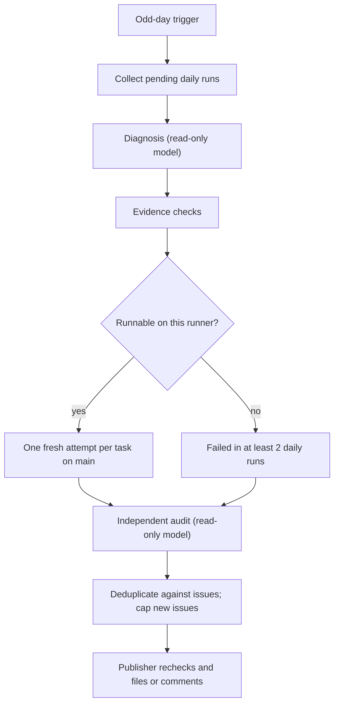

# Benchmark 自动改进

> 状态：配置前处于禁用状态。分析已在自托管 runner 上运行过，并在合并前的试运行中提交了一个真实的 issue；
> 在新窗口中对已打开 issue 追加评论的行为已有测试覆盖。该流水线从不修改代码。

自动改进（auto-improve）会分析已完成的每日基准测试运行，并将有证据支撑的缺陷报告为 GitHub issue。
开发者在本地修复每个 issue，通常借助编码 Agent；issue 的写法就是为了作为该 Agent 的起点。
仓库中不会有任何内容被自动修改。

错误的 issue 比遗漏的 issue 代价更高。因此每个发现在提交前都要通过机械化的证据检查、在当前 `main`
上的一次全新运行（对于本 runner 无法执行的任务，则要求至少在两次每日运行中失败），以及一次独立审计；
并且每次运行最多提交三个新 issue。



## 流水线

1. **发现。** 工作流在奇数日的 UTC 01:37 运行，收集 `main` 上所有待处理的定时 `Benchmark` 运行，
   这些运行需在 3 小时到 13 天前之间完成。更早的运行不再符合条件。如果待处理的运行超过 13 个，
   发现阶段会报错停止，而不是丢弃证据；请使用 `source_run` 子集手动分派，在它们过期前处理掉。
   每个任务按每日运行保留各自的结果。在任何任务运行之前就失败的运行（其产物只包含仪表盘）
   会作为空来源留在窗口内。发现阶段还会加载仓库中已有的 auto-improve issue 以及人们对它们的处理结果。
2. **诊断。** 一个只读的 Claude Code 会话审阅所有失败及其 trace、Judge 理由、截图和源代码，
   并把共享同一根因的失败归组为发现（finding）。每个发现都有一个领域：
   - `agent`：Agent 的 Go 代码、提示词、工具描述或 Skill；
   - `benchmark`：runner、任务定义、评分或环境中的评估缺陷，且具有可观察的症状，例如 setup 失败、
     Judge 错误、环境故障、工具结果失败、硬断言或错误文本；
   - `external`：runner 无法执行的硬件、固件、App 或服务代码。

   该会话能看到之前的 issue，并被告知不要重新提出已被人们拒绝的发现。已有打开 issue 跟踪的原因，
   会带着该 issue 的目标再次提出，从而被复现，并让该 issue 收到一条跟进评论。
3. **证据检查。** 受信任的代码会丢弃以下发现：引用了在窗口内未观察到失败的任务、没有引用任何仓库中现存的源文件，
   或没有证据。Agent 发现必须针对计入 Agent 的失败，并且诊断本身没有将其归因于评估器或环境。
   Benchmark 发现需要有有效的症状。
4. **复现。** 对于其任务可由本 runner 执行（`isolated` 和 `mobilegym`）的发现，会在当前 `main`
   上、在一个全新的守护进程中将每个目标任务运行一次。当该次尝试失败且可评估时，Agent 发现即被复现；
   Judge 错误或环境故障不算。当症状再次出现时，Benchmark 发现即被复现；这些尝试不会重新评判，
   因此 Judge 失败会保持可见。至少要有一个目标被复现。runner 无法执行的发现则必须在窗口内的
   至少两次每日运行中失败过。
5. **审计。** 第二个只读会话接收这次全新尝试的证据和历史观察，并尝试驳倒该发现：在检查所声称的原因之前，
   先检查评估器的范围、setup、环境和模型的不稳定性。只有 `confirmed` 的发现才会继续。
   一个 issue 对应一个根因和一个修复：审计者列出共享该根因的目标（至少包含一个已复现的目标），
   并在去重前将发现收窄到这些目标。诊断归为一组但原因不同的目标留给以后的发现。
   审计者撰写 issue 内容，将观察、根因和可选的修复方向分开，并且只提出已对照合理用途
   （例如相邻任务）检查过的方向。随后受信任的代码会检查该 issue 是否至少引用了一个仓库中现存的文件，
   并写明了验收标准。
6. **去重与限额。** 发现按领域和目标任务识别，而不是按模型的措辞。与流水线之前提交的 issue 对比：
   - 与某个打开的 issue 共享目标时，该 issue 每个窗口收到一条评论，而不是提交重复 issue；
   - 以“不计划处理”关闭，或带有 `invalid`、`wontfix`、`duplicate` 或
     `auto-improve:false-positive` 标签的已关闭 issue，会抑制目标被其覆盖的发现；
     这些发现不会被复现或重新提交；
   - 以“已完成”关闭的 issue 会在新 issue 中被链接，作为可能的回归。

   在同一次运行中，与之前某个发现重叠的发现会被丢弃。新 issue 按已复现的目标数、失败的每日运行数和覆盖广度排序，
   最多提交 `AUTO_IMPROVE_MAX_ISSUES`（默认 3）个。
7. **发布。** 一个只拥有 `issues: write` 权限的独立作业从 `issues.json` 中提交草稿。
   它会先将每个草稿与仓库当前的 issue 重新核对，因此重试是幂等的，并且会尊重自发现阶段以来新提交或关闭的 issue。

issue 元数据是正文中的一段隐藏注释。只有由工作流机器人（`github-actions[bot]`，或
`AUTO_IMPROVE_ISSUE_AUTHOR` 中的登录名）创建的 issue 才会在去重和抑制时被信任，
因此他人撰写的 issue 无法抑制或重定向发现。

## Issue 内容

每个 issue 都带有 `auto-improve` 标签，标题以 `[auto-improve][<domain>]` 开头，并包含：

- 一个头部，说明修复应落在哪里（Go 代码、提示词、工具描述、Skill、benchmark 代码、任务定义或外部代码）、
  失败的 Agent 模型，以及失败是否依赖模型：即代码或提示词已经写明了正确行为，而模型没有遵循，
  由维护者决定是加固代码还是接受现状；
- 摘要以及对用户可见的影响；
- 受影响任务的表格，包含其环境、失败的每日运行数量，以及该任务在分析所用的分支和提交
  （定时运行为 `main`）上是否复现；
- 以 CI 相同方式运行每个任务的命令（`--auto-agent-setup`，加上该用例的执行模式和目标平台），
  以及任务需要环境桥接时的说明；
- 预期行为、实际行为和根因；
- 以分析时所用提交为基准的代码位置永久链接，这样后续修改不会让引用的行发生偏移；
- 证据引用以及指向本次运行产物的链接（保留 14 天）；其中每个发现的 `daily-observations.json`
  保存了其任务在每次每日运行中的结果，便于核查失败历史；
- 修复必须满足的验收标准，以及一个可选的、非约束性的修复方向。

模型撰写的文本被视为不可信：其中的提及会被破坏以免通知任何人，HTML 注释会被转义以免伪造元数据，
各字段都有长度限制。元数据、任务表格和命令等结构性部分由受信任的代码生成。

要拒绝某个发现，请以“不计划处理”关闭该 issue，或添加 `auto-improve:false-positive` 标签后关闭。
打开状态的 issue 永远不会被视为已拒绝：后续运行会在其上追加评论。一旦关闭，流水线就不会在该领域中再次为这些任务提交 issue，
下一次诊断也会看到这一结果。

## 运行与测试

入口包括[工作流](../../.github/workflows/auto-improve.yml)、
[驱动程序](../../benchmark/ci/auto_improve/driver.py)、
[issue 渲染器](../../benchmark/ci/auto_improve/issues.py)以及
[发现与发布器](../../benchmark/ci/auto_improve/control.py)。

该工作流只在 `main` 上运行；其他分支和 pull request 永远不会触发它。

- **手动运行。** 从 `main` 分派。没有 `publish_issues=true` 时只进行分析：产物包含 `issues.json`
  和渲染后的 `issues/*.md`，不会向 GitHub 写入任何内容。只有在 `publish_issues=true` 时才会提交 issue：

  ```bash
  gh workflow run auto-improve.yml --ref main -f publish_issues=true
  ```

  添加 `-f source_run=<id>[,<id>...]` 以选择特定的已完成每日运行。
- **定时。** 设置 `AUTO_IMPROVE_ENABLED=true`。`main` 上的定时运行会提交 issue。

每次运行都会将其证据上传为 `auto-improve-<run>-<attempt>`。另一个
`auto-improve-source-<identity>` 标记会将该窗口的每日运行排除在后续发现之外，并且只在没有剩余待提交内容时上传：
要么由发布作业在每个 issue 操作都成功后上传，要么在已结束的运行（`completed` 或 `no_failures`）
没有 issue 操作时直接上传。出错、被取消、无法执行复现尝试、发布失败或只做了分析
（没有 `publish_issues=true` 的手动运行）的运行不会上传标记，因此下一次运行会再次分析同一窗口。

## 配置

| 名称 | 类型 | 用途 |
| --- | --- | --- |
| `AUTO_IMPROVE_ENABLED` | Variable | 选择启用定时执行；默认禁用 |
| `AUTO_IMPROVE_REVIEW_MODEL` | Variable | 用于诊断和审计的 Claude Code 兼容模型 |
| `AUTO_IMPROVE_REVIEW_BASE_URL` | Variable | 可选的 Anthropic Messages 兼容端点，不是 OpenAI chat-completions URL |
| `AUTO_IMPROVE_REVIEW_API_KEY` | Secret | 审阅模型凭据；只提供给审阅会话 |
| `AUTO_IMPROVE_REVIEW_MAX_TURNS` | Variable | 每个审阅会话的轮数，默认 48，范围 8-100 |
| `AUTO_IMPROVE_MAX_ISSUES` | Variable | 每次运行的新 issue 数，默认 3；在已有 issue 上的评论不计入 |
| `AUTO_IMPROVE_ISSUE_TOKEN` | 可选 Secret | 组织策略要求时用于发布的机器人 token；否则使用作业的 `GITHUB_TOKEN` |
| `AUTO_IMPROVE_ISSUE_AUTHOR` | Variable | 该机器人 token 的登录名，使其创建的 issue 在去重时被信任 |
| `AUTO_IMPROVE_DELAY_HOURS` | Variable | 每日运行完成后的最短等待时间；默认 3 |

复现复用已有的 `BENCHMARK_AGENT_*` 和 `BENCHMARK_JUDGE_*` 变量和 secret。审阅 base URL 以
`ANTHROPIC_BASE_URL` 传入，审阅 key 以 `ANTHROPIC_API_KEY` 传入。审阅会话只能用 `Read`、`Grep`
和 `Glob` 读取暂存的证据和源代码；它们不会获得任何 GitHub 或 benchmark 凭据。只有发布作业拥有写权限，
并且只限于 issue。

限制：每个审阅会话 48 轮、15 分钟，驱动程序总预算两小时，作业上限 150 分钟。没有模型费用上限；
每个会话的估算费用会记录在 manifest 和作业摘要中。

## 边界

- 流水线只报告缺陷；它不会修复缺陷、打开 pull request 或合并。
- 在 `main` 上的一次尝试只能确认失败仍然发生，不能证明它是确定性的；其余由审计和每日窗口历史提供。
- ADB 模拟器、物理手机和外部设备的任务不会被执行；它们的发现依赖反复的每日失败和审计。
- 超出 Agent、benchmark 以及外部设备或服务代码范围的发现不会被提交。
