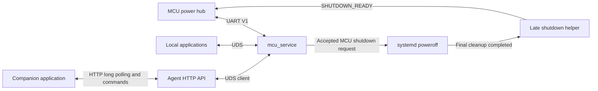

# MCU Service Implementation Plan

Design record. See [MCU Service](mcu-service.md) for the implemented interfaces
and post-flash runner; hardware shutdown acceptance remains a board test.

Status: historical design, based on the repositories inspected on 2026-10-19.
The APIs, LED extension, daemon, shutdown integration and offline tests are now
implemented. Future-tense sections below preserve the
original design requirements; follow the linked service page for current
interfaces and deployment. Physical shutdown acceptance remains outstanding.

Replace the diagnostic implementation behind `aiden-mcu-event.service` with a
production MCU service. It will handle the RV startup/shutdown handshake,
forward wake events through long polling, and expose typed timer, state,
battery and LED operations to applications.

## Sources and current behavior

| Source snapshot | Relevant implementation or specification |
| --- | --- |
| `aiden-design`, `7ee65bc` | `MCU 与 RV1106 电源与通信接口方案/MCU 与 RV1106 电源与通信接口方案.md`, especially sections 6.1–6.5 |
| `aiden-mcu`, `1bf1776` | `docs/protocol-v1.md`, `docs/application.md`, `include/aiden/v1.h`, `src/protocol/v1.c`, `src/app.c`, `src/power/supervisor.c` |
| This checkout, `5d3a447d` | Diagnostic UART service (`overlay-debian/usr/lib/aiden/aiden-mcu-event` at the recorded revision), [systemd unit](../../overlay-debian/etc/systemd/system/aiden-mcu-event.service), protocol tests (`tests/test_mcu_event_service.py` at the recorded revision), and [deployment description](../01-getting-started/deployment.md) |
| Existing application integration | [BLE service](ble-service.md), `src/agent/internal/ble/{event_store,uds,client}.go`, and the Agent HTTP routes in `src/agent/internal/agent/server.go` |

The design defines wire semantics; the MCU source supplies implementation
constraints such as payload bounds, sequence reuse and timer persistence.

The existing Python service owns `/dev/ttyS5` at 115200 8N1. It sends
`RV_READY`, answers `GET_STATE` with a fixed READY state and version 0.1.0,
and logs events. Valid `SHUTDOWN_REQUEST` receives DENIED. It has no application
socket, outgoing request engine, timer/battery API or production shutdown path.

Several distinctions must survive the replacement:

- `GET_STATE` (`0x01`) is **MCU → RV**. Its version and state describe the RV
  service. The MCU explicitly denies an RV-originated `GET_STATE`; V1 has no
  command for reading the MCU firmware version or complete power-supervisor state.
- `WAKEUP` (`0x07`) already contains its source. There is no wake-source query.
  Source `0x06` means ASR; it is unrelated to command `0x06`, which is `RV_READY`.
- The MCU timer is a single relative, one-shot timer maintained by SysTick.
  It survives RV power-off while MCU remains powered, but not an MCU reset.
  Calling the source RTC/TIMER does not make it an RTC-backed alarm.
- LED outputs exist on PF0 (red) and PF1 (white), with autonomous MCU policy.
  V1 currently allocates commands only through `0x0A`; LED requests need an
  additive protocol change in the design and MCU repositories.
- BLE's `events_since` currently returns immediately. Its cursor/generation
  model is reusable, but blocking waits and cancellation must be added for MCU.

## Architecture and ownership



Implement a dedicated Go executable at `src/agent/cmd/mcu_service/`, backed by
`src/agent/internal/mcu/`. Follow the BLE service's packaging and common
[12-byte UDS envelope](../06-protocols/uds-protocol.md), with a new socket at
`/run/mcu_service/mcu_service.sock`. Supply typed Go client methods and document
the envelope for other local application languages. The Agent provides a thin
HTTP adapter for companion applications; local applications can use UDS directly.

Keep the installed unit name **`aiden-mcu-event.service`** and change its
`ExecStart` to `/usr/lib/aiden/mcu_service`. Retire the Python logger and its
package-managed copy. Do not install a second service competing for ttyS5.
Preserve journal logging and the existing `aiden.target` activation entry.

The daemon exclusively owns UART during normal operation, using an advisory
lock plus terminal exclusivity where supported. UART RX, frame TX and request
scheduling are independent of API waits. Incoming MCU requests and shutdown
responses take priority over application queries. The late shutdown helper
opens UART only after the daemon has exited and relinquished ownership.

Run the small standalone daemon as root, with its application socket owned by
`root:aiden`, mode `0660`. This is an explicit change from the logger's `aiden`
user: the daemon must schedule system poweroff and create a protected shutdown
marker. The API exposes typed operations only; no raw UART, arbitrary command,
`RV_READY`, `SHUTDOWN_READY` or poweroff operation is exposed to applications.

Start the service after the UART device exists, independently of Agent startup,
networking, BLE, models and application configuration. Initialize event storage,
request dispatch and the shutdown coordinator before announcing READY. The
Agent uses a configurable `AIDEN_MCU_SERVICE_SOCKET` and reconnects when the
service is unavailable; desktop operation without MCU hardware remains possible.

## UART transport and recovery

Preserve version 1, little-endian serialization and CRC-16/CCITT-FALSE over VER
through PAYLOAD. Use the MCU's 64-byte payload limit and 100 ms partial-frame
expiry. Resynchronize after garbage, bad CRC, invalid type/version or oversized
length without discarding a valid following frame. Validate exact command
lengths, reserved fields, enum ranges and response STATUS before using data.

Use one outbound request at a time, with a bounded application queue. Match
responses by both SEQ and CMD. Retry the identical request frame at 100 ms
intervals, at most three retries after the initial send; terminate at 400 ms.
Ignore unsolicited and late responses. Queue delay has a separate deadline;
overload returns BUSY instead of growing memory without bounds.

Mirror MCU duplicate semantics for inbound requests: 16 entries retained for
two seconds, reserved before side effects; identical SEQ/CMD/payload replays
the original response, conflicting payload returns INVALID, and a full live
cache returns BUSY. Bound response enqueue retries to the MCU's 100 ms budget.
Maintain an independent shutdown latch so a later request with a new SEQ, or
one arriving after cache expiry, cannot initiate a second shutdown transaction.

Quarantine outbound request sequences for 2.4 seconds after their initial
attempt. On daemon startup/reopen, quiesce the previous UART owner and enforce
a two-second guard before new outbound requests; random initial SEQ is an
additional precaution. Drain stale responses, but continue parsing valid
events and answering MCU requests. During initialization `GET_STATE` returns
BOOTING, unless a pending shutdown transaction must be resumed. Do not throw
away valid wake events merely because an application has not connected yet.

After initialization, send `RV_READY` with `01 00 00 00`. Answer MCU
`GET_STATE` with six bytes: SUCCESS, protocol version, RV service semantic
version (three bytes), and RV state. READY in that response is `0x02`, whereas
the READY event's first payload byte is `0x01`. MCU polling recovers a lost
READY event; do not synthesize WAKEUP on recovery or ordinary startup.

Report link health using last valid RX time, last completed request and error
counters. A successful UART open or transmitted READY event alone does not
prove MCU availability. Loss of communication never requests Linux poweroff.
V1 has no session identifier, so exactly-once delivery across peer resets and
unambiguous detection of every MCU reset cannot be promised.

## Startup and shutdown behavior

RV protocol states are BOOTING (`0x01`), READY (`0x02`) and SHUTTING_DOWN
(`0x03`). They describe communication/lifecycle readiness, not whether every
application has finished loading. The MCU owns switch races, power rails,
queued restart decisions and the mandatory off gap; RV does not toggle RV_HOLD.

For a valid MCU `SHUTDOWN_REQUEST` (`0x09`, payload `01 00 00 00`):

1. Reserve duplicate-response state, latch shutdown and stop accepting
   application mutations. Record a root-owned, current-boot intent atomically
   before acknowledging acceptance, so a crash after ACK cannot lose the
   transaction. Keep this bounded work on tmpfs, outside userdata I/O.
2. Store that intent in a separate directory
   under `/run/aiden-mcu-poweroff/`. This directory must survive ordinary
   daemon stop/RuntimeDirectory cleanup. Store the first receipt time and
   transaction identity; a daemon restart must resume this intent and must
   never reannounce READY while it is pending. Cache and send SUCCESS within
   100 ms through the priority TX path. Duplicates replay it without restarting
   work or deadlines. If intent setup fails, return INTERNAL_ERROR and attempt
   emergency orderly cleanup; the MCU's deadline still applies.
3. Asynchronously request the fixed systemd poweroff operation. Do not block
   UART dispatch on process cleanup or a synchronous systemctl invocation.
   Scheduling failures remain visible and are retried within the original
   deadline; they do not cancel the MCU's forced-off timer.
4. While the daemon remains alive, answer `GET_STATE` as SHUTTING_DOWN, reject
   new hardware mutations, and cancel API waiters. Let systemd stop writers,
   flush application state, deactivate swap and finish filesystem teardown.
5. A small statically linked helper installed in
   `/usr/lib/systemd/system-shutdown/` verifies the `poweroff` action and the
   current-boot intent. It runs in the final shutdown phase, after normal
   services are gone. It checks that relevant persistent filesystems are
   unmounted or read-only and swap is inactive; failed checks withhold READY.
   It takes UART ownership, writes `SHUTDOWN_READY` (`0x0A`, `01 00 00 00`),
   and drains transmission with a bounded deadline before exiting.

The helper requires no Agent, D-Bus, Python, writable userdata or network.
Its executable and intent marker must remain readable in that late phase;
validate this on the shipped Debian/systemd image. Audit other shutdown hooks
because hooks can run in parallel: none may perform critical writes after
this helper signals completion. Normal daemon `ExecStop` and a bare `sync`
are insufficient evidence that power removal is safe.

Ordinary service stop, package upgrade, daemon crash and Linux reboot never
emit SHUTDOWN_READY or create MCU shutdown intent. In particular, do not map
every SIGTERM/reboot to wire SHUTTING_DOWN: the MCU interprets that state as
permission to enter its bounded power-off path. The first implementation
coordinates MCU-requested poweroff; a future application-requested poweroff
must define its MCU target/restart semantics separately.

### Deadline that must be resolved before enabling production shutdown

The design allows **30 seconds from the initial shutdown request**, regardless
of SUCCESS, DENIED, BUSY or missing ACK. The current MCU actually starts that
clock when its supervisor enters SHUTTING_DOWN, before UART enqueue/delivery.
After SHUTDOWN_READY, it waits **75 ms** before cutting power. ACK only confirms
receipt.

The implementation reduces `aiden-agent.service` to `TimeoutStopSec=10s` and
`aiden-swap.service` to 5s; several dependent services each still have 10s.
Their shutdown dependency chain can compound these delays, so these settings
alone do not demonstrate that the full path satisfies the budget.

Set a measured target of no more than 25 seconds from the MCU's first request
to fully transmitted SHUTDOWN_READY, preserving at least five seconds of
margin. Budget application cancellation, dependent service stops, swapoff,
filesystem flush/unmount and the final helper as one complete critical path.
Use approximately 10 seconds for application cleanup, five for dependent
resources, and five for final storage cleanup as initial engineering targets;
derive individual unit limits and cancellation changes from that path.
An RV receipt timestamp can underestimate elapsed MCU time by queue/retry/link
delay; board acceptance must measure from the MCU state transition.

Shorter systemd timeouts alone do not prove data safety. Test active writes,
swap pressure, backup/restore and OTA activity. If the complete path cannot
meet the fixed deadline, update the design and MCU timeout together before
enabling the production handshake. Never send READY early to hide slow cleanup.
Faulted storage may still reach the MCU's forced cutoff; make that outcome
explicit in validation and diagnostics.

## Application API

Proposed UDS operations and their Agent HTTP equivalents:

| UDS operation | HTTP method and path | Meaning |
| --- | --- | --- |
| `get_state` | `GET /api/mcu/state` | Local RV state/version, service generation, UART health, last RK628 state and LED support |
| `get_battery` | `GET /api/mcu/battery` | Issue MCU command `0x02` and normalize its response |
| `get_wakeup_timer` | `GET /api/mcu/wakeup-timer` | Issue `0x04` for timer ID zero |
| `set_wakeup_timer` | `PUT /api/mcu/wakeup-timer` | Issue `0x03` with enabled delay |
| `cancel_wakeup_timer` | `DELETE /api/mcu/wakeup-timer` | Issue `0x05`; return confirmed inactive state |
| `events_since` | `GET /api/mcu/events` | Cursor-based event history with optional long polling |
| `get_led` | `GET /api/mcu/leds/{red\|white}` | Read LED configuration and effective output, after MCU extension |
| `set_led` | `PUT /api/mcu/leds/{red\|white}` | Select auto/off/on/blink with a bounded override lease |

The HTTP adapter uses the existing BLE control restriction to USB ECM or
loopback. It passes request cancellation to UDS and returns `Cache-Control:
no-store`. It does not consume events into a separate Agent queue. Both local
applications and companion applications therefore see the same generation
and cursor space, even across an Agent restart.

Return named errors plus the original `mcu_status` when one exists. Distinguish
invalid arguments (HTTP 400), denied operations (403), unsupported optional
LED commands (501), temporary BUSY/NOT_READY/unavailable state (503), transport
deadline (504), malformed MCU replies (502), and internal failures (500).
For mutations, generation mismatch or reuse of an ID with different arguments
is 409. Event generation reset uses an HTTP 200 page with `reset_required`.
Successful long-poll timeout is HTTP 200 with an empty event array. Reject
nonempty UDS binary payloads; cap JSON requests at 16 KiB and responses at
256 KiB before allocating or decoding them.

Mutations require a client-generated `request_id` and the current service
`generation`. Retain results and in-flight records in a bounded 512-entry,
10-minute idempotency cache; refuse new mutations when all entries are live.
Reusing an ID with the same operation and arguments returns its original
result; conflicting reuse is rejected. Reject a stale generation before
touching UART. This prevents an HTTP retry from silently restarting a timer
after a daemon restart. A transport timeout after transmission has an
**unknown outcome**: preserve that result, query current state to reconcile,
and require a deliberate new request ID for another mutation. The cache gives
no deduplication guarantee after expiry: clients must reconcile instead of
replaying expired IDs. They must not retry mutations automatically with a new
UART request. HTTP carries these fields in mutation bodies, including DELETE;
the client wrapper hides that transport detail.

### WAKEUP long polling

Use a bounded in-memory ring, initially 512 events, with monotonically
increasing decimal-string IDs and a random daemon generation, following BLE.
Keep event storage alive independently of the Agent and all consumers.

```json
{"op":"events_since","since":"41","generation":"g1","limit":50,"wait_ms":25000}
```

```json
{
  "status": "OK",
  "generation": "g1",
  "events": [
    {
      "id": "42",
      "type": "wakeup",
      "source": "asr",
      "source_code": 6,
      "uart_seq": 37,
      "received_at": "2026-10-19T08:00:00Z"
    }
  ],
  "next_id": "42",
  "oldest_id": "1",
  "last_id": "42",
  "reset_required": false,
  "truncated": false
}
```

The matching HTTP query is
`/api/mcu/events?since=41&generation=g1&limit=50&wait_ms=25000`.
Define the following behavior explicitly:

- `since` is exclusive. Start with `since=0` and no generation to read retained
  history. Subsequent reads include the returned generation. `limit` defaults
  to 50 and accepts 1–100; `wait_ms` accepts 0–25000. UDS defaults to immediate
  reads; HTTP defaults to 25000 ms.
- Return available events immediately. Otherwise wait for append, timeout,
  cancellation or shutdown. A timeout returns `events: []` and preserves the
  cursor. Check the ring and register the wake notification atomically so an
  event arriving between those actions cannot be missed.
- `next_id` is the last event actually returned, or the input cursor on an
  empty page. `last_id` is the ring high-water mark. Clients advance to
  `next_id`, never to `last_id` when a page is limited.
- Generation mismatch returns `reset_required=true` with no events and no
  wait; retry from zero with no generation. A nonzero cursor requires a
  generation. An ahead-of-history cursor also requires reset. An evicted
  cursor returns retained events with `truncated=true`; a read from zero
  also reports truncation when earlier events have already been evicted.
- Readers have independent cursors; reading never consumes an event for
  another reader. Applications deduplicate handled actions by `(generation,
  id)`. UART SEQ wraps and is diagnostic only, not an event ID or dedupe key.
- Bound active connections and waiters, initially 64 connections and 32
  long-poll waiters, and reserve control capacity. Waiting never holds UART
  or state locks. Cancel active waits and close connections during service
  shutdown. Use dedicated client connections for waits so ordinary commands
  remain responsive.
- BLE's 10-second UDS server deadline and five-second default client deadline
  cannot be copied unchanged. Use a bounded request-read deadline, then a
  response deadline of `wait_ms` plus transport margin (five seconds), capped
  by the caller's deadline. Propagate cancellation by closing the connection;
  enforce the same behavior through HTTP and its client timeout.

For WAKEUP, require exactly four payload bytes with three zero reserved bytes.
Map sources 1–6 to `external_power`, `power_switch`, `touch_key`, `rtc_timer`,
`other`, `asr`. Preserve unknown values as `source: "unknown"` plus
`source_code`; they do not select a known application action. Malformed events
increment diagnostics and never enter the application wake stream. Do not ACK
WAKEUP, issue a source query, or invent a wake for normal switch startup.

Preserve `RK628_PLUGIN_DET_CHANGED` as a separate event type in the same ring
and cache its latest valid state for `get_state`. Validate length, reserved
bytes and active-low inserted/raw-level consistency. Consumers advance their
cursor over all event types, even when acting only on WAKEUP.

Application code chooses what touch, ASR and timer wake mean. The Agent's
voice consumer must replace direct GPIO32/GPIO33 activation with
`WAKEUP(source=asr, source_code=6)` from a local UDS long poll, preserving STT,
follow-up, realtime and interruption behavior. Other event sources must not
automatically activate voice. Keep Quick Capture GPIO separate. Preserve the
consumer cursor across voice reloads and Agent restarts within a boot, handle
reconnect/generation reset/pagination, cancel waits on stop and skip obsolete
history. The service itself does not start voice recording or conflate MCU
wake with the BLE notification used to wake a phone. See
[Agent voice activation](./mcu-service.md#agent-voice-activation) for the
implemented consumer policy and its delivery limits.

Delivery is replayable while events remain in this daemon's ring. It is not
durable or exactly once: MCU coalesces unsent triggers to the latest source,
UART EVENT has no ACK/retry, and daemon restart clears history. The API makes
known local gaps visible but cannot recover a wake lost before UART receipt.

### Timer operations

Expose `delay_s` as an integer in 1–604800; hide the fixed timer ID zero in the
typed application client. Encode SET as `00 01 <delay_s:LE32>`, and GET/CANCEL
as `00`. Application cancellation uses CANCEL; the low-level codec still
validates SET with `enable=0`, for which MCU ignores delay.

All three responses are eight bytes: STATUS, ID, active, reserved,
remaining seconds LE32. Require ID zero, active 0/1 and reserved zero; return
the MCU's confirmed `{timer_id: 0, active, remaining_s}`. Remaining time rounds
up in MCU firmware. Do not turn a status-only error into an inactive timer.

There is one shared timer, not one timer per client. Serialize changes; the
latest accepted SET replaces the previous configuration. Include
`request_id`/`generation` on SET and CANCEL retries. MCU duplicate replay must
not reset the countdown. Expiry is surfaced as WAKEUP source 4 and can occur
while RV is already READY without a power cycle. Do not automatically restore
an old timer after MCU reset or pretend it survives loss of MCU power.

### State and battery operations

`get_state` reads the same local RV lifecycle state used in the MCU-facing
GET_STATE response, plus daemon health and event generation. Name fields
`rv_state`, `rv_service_version`, `protocol_version`, `uart_connected`,
`last_rx_at` and `led_support`; describe UART-open versus peer-health semantics.
Do not issue command `0x01` toward MCU or label RV version as MCU version.
If applications later need MCU supervisor state/version, allocate a distinct
command and define its response in the shared protocol.

`get_battery` sends an empty command `0x02` request. Its successful response is
**six bytes**: STATUS, percent, voltage LE16, charge state, reserved. Map
percent `0xFF` and millivolts `0xFFFF` to JSON `null`, retaining raw fields for
diagnostics. Map charge states 0–3 to not_charging, charging, full and
absent_or_unknown; do not infer zero charge from unknown data.

Expose query receipt time, but do not label it as a hardware sample time.
The MCU refreshes snapshots roughly every five seconds and reports unknown
fields when the last complete snapshot exceeds 15 seconds. V1 does not expose
sample age. An explicit application query should read MCU state; the first
implementation adds no extra persistent battery cache.

## Proposed LED protocol extension

Reserve the following currently unassigned IDs in the design, its MCU reference
copy, `docs/protocol-v1.md` and both implementations before shipping support.
These are proposals, not commands supported by the inspected MCU image.

| CMD | Direction | Request | Successful response |
| --- | --- | --- | --- |
| `0x0B SET_LED` | RV → MCU REQ | Eight bytes: led_id, mode, on_ms LE16, off_ms LE16, lease_s LE16 | Same 12-byte state as GET_LED |
| `0x0C GET_LED` | RV → MCU REQ | One byte: led_id | STATUS, led_id, requested_mode, effective_mode, on_ms LE16, off_ms LE16, remaining_s LE16, output_level, override_reason |

LED IDs are red `0`, white `1`; logical output 1 means illuminated. Modes are
auto `0`, off `1`, on `2`, blink `3`. On/off are logical modes, not brightness
or PWM. This board exposes two discrete LEDs, so RGB and dimming are outside
this extension.

Validation and behavior:

- Auto requires zero timing and lease fields and releases the override.
  Off/on require zero on/off durations and a lease of 1–3600 seconds.
  Blink requires on/off durations of 20–60000 ms each and a lease of
  1–3600 seconds. Reject all other values with STATUS-only INVALID.
- A SET starts/replaces that LED's lease and resets blink phase to ON.
  A duplicate request returns the original cached response without extending
  the lease or restarting phase. GET reports remaining lease rounded up.
- Leases use monotonic MCU time and expire back to auto. Clear overrides on
  MCU reset and when RV enters shutdown/off; do not revive them at next boot.
  A lease continues to age while a higher-priority indication masks it.
- Keep the initial 150 ms boot indication and red low-battery/charging policy
  above application overrides. For other states, application override wins
  over the existing red running indication and white heartbeat. Auto always
  uses existing MCU policy; do not rewrite the GPIOs from an unrelated path.
- `effective_mode=auto` indicates an autonomous pattern. Return the actual
  instantaneous `output_level` and `override_reason`: application `0`, auto
  `1`, boot `2`, low_battery `3`, charging `4`, shutdown_or_off `5`.
  Requested mode/timing remain visible while masked. After lease release or
  expiry, requested mode is auto and timing/remaining fields are zero.
- Admit SET overrides only while the MCU considers RV READY. Read current
  state without changing it. Implement pattern selection in
  `aiden_app_leds()`; preserve `board_led_write()` as the hardware abstraction.

Example application mutation:

```json
{
  "op": "set_led",
  "led": "white",
  "mode": "blink",
  "on_ms": 200,
  "off_ms": 800,
  "lease_s": 30,
  "request_id": "d23c3b7e-90e3-4f18-a594-cba1a4f33216",
  "generation": "g1"
}
```

Use read-only GET_LED with a valid ID as an optional capability probe after
readiness. Old MCU firmware returns INVALID for this unassigned command;
report `led_support=unsupported` and keep all existing features usable.
Timeout/NOT_READY means unknown, not unsupported. Reprobe after reconnect
and allow explicit refresh rather than permanently caching absence across
an MCU update. A new MCU must retain all `0x01`–`0x0A` behavior. Keep V1 framing
unchanged and version the additive command contract in documentation.

## Implementation sequence and affected files

| Phase | Work and main locations | Exit condition |
| --- | --- | --- |
| 1. Freeze contracts | Design and MCU protocol documents; golden frames in firmware tests; application JSON schemas/examples; agree LED IDs and priorities | Directions, lengths, errors and proposed extensions are consistent across all three repositories |
| 2. Build service core | `src/agent/cmd/mcu_service/`, `src/agent/internal/mcu/{protocol,transport,service,event_store,uds,client}*.go` | Simulated UART handles simultaneous requests/events, restart guard, duplicates, timer/battery and cancellable long polling |
| 3. Integrate applications | `src/agent/internal/agent/server.go`, dedicated MCU handlers/tests, Agent socket configuration, client example | Local UDS and USB HTTP clients independently receive the same wake and can query/control supported features |
| 4. Complete shutdown | Daemon shutdown coordinator, final static helper, service ordering and stop budgets, Agent cancellation and swap cleanup | Measured full cleanup fits below 25 seconds and READY is emitted only at the final safe point |
| 5. Implement LED extension | MCU `include/aiden/v1.h`, `include/aiden/app.h`, `src/app.c`, protocol/peer tools and tests; RV codec/API | Old MCU remains usable; new MCU implements queries, leases, duplicate replay and priority rules |
| 6. Replace installed logger | Existing `aiden-mcu-event.service`, remove Python implementation, build/audit/package lists, config catalog and deployment docs | Upgrade/restart/rollback have one UART owner; all required artifacts and tests are packaged |

Shutdown coordination must be complete before deploying a replacement that
ACKs production shutdown. Phases 2–3 can be tested with injected transports
and a fake poweroff executor without changing hardware behavior.

Packaging updates include `scripts/debian-apps/container-build-apps.sh`,
`scripts/debian-apps/audit-apps.sh`, `scripts/debian-package/container-build.sh`,
`scripts/debian-package/maintainer-script.sh`,
`scripts/debian-system/config-package.json`, image audits and overlay tests.
The final shutdown-hook path is outside the catalog's current
`usr/lib/aiden/aiden-*` include, so it needs explicit staging, executable mode,
upgrade/removal ownership and validation. Ensure the old logger cannot be
restored from a managed-config copy during upgrade. Keep the stable service
name in lifecycle/rollback handling and test rollback without poweroff.

Update deployment, boot-services, paths/artifacts, UDS and service API docs
when implementation lands. Keep this proposal visibly separate from deployed
API documentation until its phases are complete.

## Validation and acceptance

Add deterministic coverage using fake time, a simulated MCU/PTY and a fake
shutdown executor. Host tests never invoke real poweroff or open board UART.

| Area | Required scenarios |
| --- | --- |
| Transport | Literal cross-repository wire vectors; partial/multiple frames; corruption and timeout resync; partial TX/backpressure; sequence wrap/quarantine; mismatched/late replies; duplicate conflict/full cache; reopen guard |
| Lifecycle | BOOTING/READY state bytes; readiness without Agent; MCU reset/recovery probes; OFF during boot; repeated shutdown with same/new SEQ; ON/touch/ASR during shutdown; link loss; restart with pending shutdown intent |
| Wake delivery | All six sources; unknown source; malformed reserved/length; wake before first subscriber; two independent consumers; limited-page cursor correctness; append/wait race; timeout/cancel/disconnect; truncation/generation reset; ordinary boot produces no synthetic wake |
| Queries/mutations | Battery unknown/stale fields and six-byte response; timer bounds/replace/cancel/expiry; one shared timer; idempotent HTTP/UDS retries and ambiguous timeout; errors remain distinct from valid zero values |
| Shutdown | ACK within 100 ms; 30-second deadline never resets; no early READY; late helper gating/ownership/TX drain; storage or hook failure; no signal on reboot, package replacement or ordinary service stop |
| LED | New wire vectors; invalid IDs/modes/length/ranges; lease expiry; blink timing; priority masking; duplicate replay; shutdown/reset clearing; old-firmware unsupported detection |
| Packaging/API | Exactly one ttyS5 owner; unit and hook executable modes; UDS permissions; USB/loopback route restriction; long polls do not block commands or service stop; upgrade and rollback remove incompatible old paths |

Replace `tests/test_mcu_event_service.py` with meaningful production contract
coverage while preserving its golden frames and invalid-WAKEUP cases. Update
the `mcu-event-service` suite and manifest-runner expectations. Explicitly add
focused MCU Go tests to the quick profile: the current `go-unit` quick command
runs only `TestShared` in `internal/ota`, so merely adding Go tests would leave
them outside `make check`.

For changes in this repository, run **`make check`** from its root. Use the
Docker runner's focused suites while implementing. Full validation remains
CI's `make check-full`, or an explicit local full-suite investigation. MCU
source/tooling changes separately require `./scripts/build.sh`,
`./scripts/test.sh`, and `python3 scripts/verify_dependencies.py` in `aiden-mcu`.
Report unavailable Docker/toolchains as untested, not as a passing result.

Board acceptance must measure UART ACK latency, last critical write, complete
READY frame transmission and VSYS removal under load. Exercise timer wake
while RV is off, ASR and touch wake, OFF during startup, queued restart during
shutdown, UART interruption, MCU reset, and LED priority/lease behavior.
Record the exact flashed images and distinguish proven paths from untested
ones. Existing records establish timer-source UART delivery, not production
Linux shutdown or every physical wake input.
