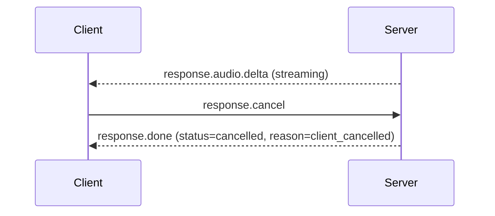

The Qwen-Audio Realtime API provides real-time voice conversations over WebSocket. Clients interact with the server by sending and receiving JSON events, with support for audio input, text input, voice activity detection (VAD), and streaming audio and text output.

**User guide**: [Real-time voice conversations (Qwen-Audio-Realtime)](https://help.aliyun.com/zh/model-studio/fun-audiochat-realtime). For details about client and server events, see [Client events](https://help.aliyun.com/zh/model-studio/fun-audiochat-client-events) and [Server events](https://help.aliyun.com/zh/model-studio/qwen-audio-realtime-server-events).

**Important**

Alibaba Cloud Model Studio provides workspace-specific domains in the China (Beijing) and Singapore regions for improved inference performance and stability. Migration to the new domains is recommended:

-   China (Beijing) region: Migrate from `dashscope.aliyuncs.com` to `{WorkspaceId}.cn-beijing.maas.aliyuncs.com`

-   Singapore region: Migrate from `dashscope-intl.aliyuncs.com` to `{WorkspaceId}.ap-southeast-1.maas.aliyuncs.com`

Replace `{WorkspaceId}` with your actual [Workspace ID](https://help.aliyun.com/zh/model-studio/obtain-the-app-id-and-workspace-id#d3eb3cd37b7fu). Existing domains remain available.

## **API endpoints**

Use the following WebSocket URLs, specifying the model with the `model` query parameter (replace `<model_name>` with the actual model):

## China (Beijing)

`wss://{WorkspaceId}.cn-beijing.maas.aliyuncs.com/api-ws/v1/realtime?model=<model_name>`

Replace `{WorkspaceId}` with your actual [Workspace ID](https://help.aliyun.com/zh/model-studio/obtain-the-app-id-and-workspace-id#d3eb3cd37b7fu) when making requests.

## Singapore

`wss://{WorkspaceId}.ap-southeast-1.maas.aliyuncs.com/api-ws/v1/realtime?model=<model_name>`

Replace `{WorkspaceId}` with your actual [Workspace ID](https://help.aliyun.com/zh/model-studio/obtain-the-app-id-and-workspace-id#d3eb3cd37b7fu) when making requests.

**Important**

The URL must use `wss://`. Set Authorization in the request headers and specify the model with the URL query parameter `model`.

## **Request headers**

Include the following information in the request headers:

| **Parameter** | **Type** | **Required** | **Description** |
| --- | --- | --- | --- |
| Authorization | string | Yes   | Authentication token in the format `Bearer <your_api_key>`. Replace `<your_api_key>` with your actual API key. |
| user-agent | string | No   | Client identifier for server-side source tracking. |
| X-DashScope-WorkSpace | string | No   | Alibaba Cloud Model Studio workspace ID. |

**Important**

Authorization is validated during the WebSocket handshake. If the API key is invalid or missing, the handshake fails with an HTTP 401/403 error.

## **Core concepts**

-   **Session**: Each WebSocket connection corresponds to one session, which maintains configuration and conversation context.

-   **Conversation Item**: A message in the conversation, organized in linked-list order.

-   **Response**: Output produced by one model inference, containing one or more output items. Items can be assistant messages or function calls.

-   **Function Call**: An output item requesting that the client execute a tool function. After execution, the client submits the result with `function_call_output`, then triggers the next inference with `response.create`.

-   **Turn Detection**: Controls when inference is triggered.

## **Interaction modes**

The Qwen-Audio Realtime API supports three interaction modes, configured through the `turn_detection.type` parameter in the `session.update` event:

| **Mode** | **turn\\_detection.type** | **Description** | **Use cases** |
| --- | --- | --- | --- |
| **server\\_vad** | `server_vad` | Server-side VAD detects speech boundaries and automatically triggers inference. | Hands-free conversations, voice assistants |
| **smart\\_turn** | `smart_turn` | Combines acoustic perception and semantic understanding to identify turn boundaries rather than relying solely on voice signals. Sounds without semantic meaning (such as "um" or "ah") do not trigger a conversation turn or interrupt model speech. | Low-latency natural conversations, high-quality interruption handling |
| **push-to-talk** | — (set `turn_detection` itself to `null`) | The client manually submits audio and triggers inference. | Push-to-talk, precise control |

## **Interaction flows**

For details about client and server events, see Client events and Server events.

### **server\_vad mode**

The server performs voice activity detection on incoming audio and automatically triggers inference when speech ends.

**To enable:** Set `turn_detection.type` to `server_vad` in the `session.update` event.

## **A complete conversation turn**

The following diagram shows a typical interaction sequence in server\_vad mode:

The client and server interact in the following order:

1.  The client establishes a WebSocket connection, and the server returns a `session.created` event.

2.  The client sends `session.update` to configure session parameters, and the server returns `session.updated`.

3.  The client continuously sends `input_audio_buffer.append` to append audio data.

4.  The server detects speech start, returns `input_audio_buffer.speech_started`, and streams ASR transcription deltas through `conversation.item.input_audio_transcription.delta`.

5.  The server detects speech end and returns `input_audio_buffer.speech_stopped`, `input_audio_buffer.committed`, and `conversation.item.created`.

6.  The server automatically generates a response, streams text and audio deltas (`response.audio_transcript.delta`, `response.audio.delta`), and finally returns `response.done`.

## **User interruption**

If VAD detects the user speaking during model audio playback, the server cancels the current response (returning `response.done` with status `cancelled`), then starts a new turn of audio input and response. The following diagram shows the user interruption sequence:

### **smart\_turn mode**

Combines acoustic perception and semantic understanding to detect speech end, filtering out non-semantic sounds such as backchannels and background audio. Sounds without semantic meaning are passed through in `conversation.item.ambient_audio_transcription.delta` events without triggering a conversation turn.

**To enable:** Set `turn_detection.type` to `smart_turn` in the `session.update` event.

## **A complete conversation turn**

The following diagram shows a typical interaction sequence in smart\_turn mode:

Key differences from server\_vad mode:

-   Sounds without semantic meaning ("um", "ah", etc.) do not trigger inference; they are returned through `ambient_audio_transcription` events instead.

-   Speech initially deemed valid may be invalidated (`input_audio_buffer.speech_stopped` returns `reason=turn_invalid`), in which case inference is not triggered.

-   While waiting for the user's next input, the client can explicitly send `response.create` to trigger inference.

## **User interruption**

Interruption handling is essentially the same as in server\_vad mode. The following diagram shows the user interruption sequence:

## **Invalid turns**

Speech initially deemed valid may be invalidated (`input_audio_buffer.speech_stopped` returns `reason=turn_invalid`). Inference is not triggered, and the client should continue sending audio while waiting for the next valid speech turn. The following diagram shows the sequence for an invalid turn:

### **Speaker enhancement configuration flow**

In smart\_turn mode, providing `voiceprint_audio_urls` in the first `session.update` causes the server to register voiceprints asynchronously (loading the target speaker's audio features) and report progress through events. Voiceprint registration failure does not block normal conversations.

Voiceprint registration proceeds in the following order:

1.  After the WebSocket connection opens, the server returns `session.created`.
    The client then sends `session.update` with voiceprint audio URLs in
    `turn_detection.voiceprint_audio_urls`, which starts registration.

2.  The server immediately starts asynchronous voiceprint registration and sends a `voiceprint_audio_list.in_progress` event **before** returning `session.updated`. The event contains `item_id`, the unique identifier of this registration task.

3.  The server returns `session.updated`, confirming that the session configuration has taken effect.

4.  When voiceprint registration finishes, the server sends a terminal event (with the same `item_id` as in step 2):

    -   Registration successful: `voiceprint_audio_list.completed`.

    -   Registration failed: `voiceprint_audio_list.failed`, with a `reason` field explaining the failure (for example, the audio URL could not be downloaded).

**Note**

`voiceprint_audio_urls` only takes effect in the **first** `session.update`; subsequent values are ignored.

### **push-to-talk mode**

The client manually controls audio submission and inference triggering, suitable for push-to-talk scenarios.

**To enable:** Set `turn_detection` to `null` in the `session.update` event.

## **A complete conversation turn**

The following diagram shows a typical interaction sequence in push-to-talk mode:

```mermaid
sequenceDiagram
    participant C as Client
    participant S as Server
    loop While the user speaks
        C->>S: input_audio_buffer.append
    end
    C->>S: input_audio_buffer.commit
    S-->>C: input_audio_buffer.committed
    S-->>C: conversation.item.created
    C->>S: response.create
    S-->>C: response.created
    S-->>C: response.audio_transcript.delta / response.audio.delta
    S-->>C: response.done
```

The client and server interact in the following order:

1.  The client continuously sends `input_audio_buffer.append` to append audio data.

2.  When the user finishes speaking, the client sends `input_audio_buffer.commit` to commit the buffer.

3.  The client sends `response.create` to trigger inference manually.

4.  The server generates a response and streams text and audio.

## **User interruption**

The client sends `response.cancel` to cancel the current response, and the server returns `response.done` (with status `cancelled` and reason `client_cancelled`). The following diagram shows the user interruption sequence:

## **Operation constraints by mode**

| **Operation** | **push-to-talk** | **server\\_vad** | **smart\\_turn** |
| --- | --- | --- | --- |
| session.update | All fields editable in IDLE; some restricted outside IDLE | All fields editable in IDLE; some restricted outside IDLE | All fields editable in IDLE; some restricted outside IDLE |
| input\\_audio\\_buffer.append | Allowed  | Allowed  | Allowed  |
| input\\_audio\\_buffer.commit | Allowed  | Ignored  | Ignored  |
| input\\_audio\\_buffer.clear | Allowed  | Ignored  | Ignored  |
| response.create | Allowed (first commit buffered audio with `input_audio_buffer.commit`; cannot retrigger while a response is being generated) | Allowed when no response is being generated; cannot retrigger while a response is being generated | Allowed while waiting for the user's next input; cannot retrigger during an active turn (between receiving `input_audio_buffer.speech_started` and `response.done`) |
| response.cancel | Allowed (during inference) | Allowed (during inference) | Allowed (during inference) |
| conversation.item.create/delete/retrieve | Allowed  | Allowed  | Allowed  |

**Note**

`turn_detection` and `input_audio_format` can only be changed before audio is first sent (in the IDLE state).

## **Error handling**

| **Type** | **Behavior** | **Examples** |
| --- | --- | --- |
| Client error (`invalid_request_error`) | Connection remains open; notification only | Invalid parameters, disallowed state, duplicate item\\_id |
| Server error (`server_error`) | Connection terminated | LLM connection failure, storage failure |
