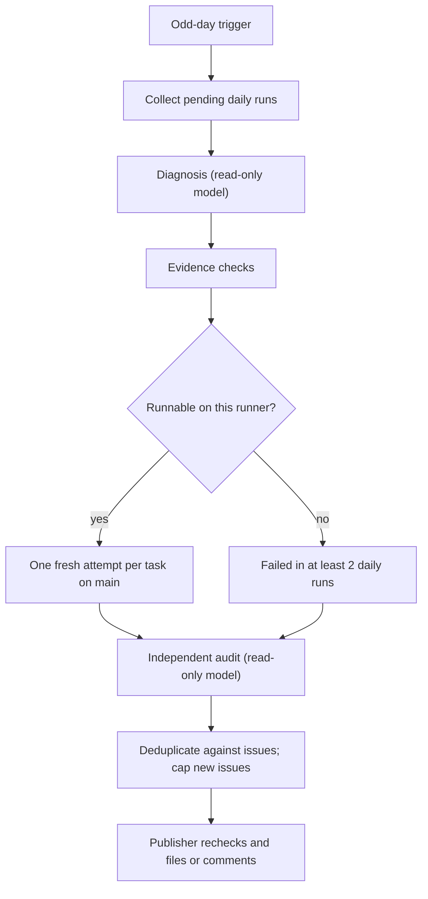

# Benchmark Auto-Improve

> Status: disabled until configured. The analysis has run on the self-hosted
> runner and filed a real issue during pre-merge trials; the follow-up comment on
> an open issue in a new window is covered by tests. The pipeline never edits code.

Auto-improve analyzes completed daily benchmark runs and reports the defects it
can support with evidence as GitHub issues. A developer fixes each issue locally,
typically with a coding agent; the issue is written to be that agent's starting
point. Nothing is changed in the repository automatically.

A wrong issue costs more than a missed one. Every finding therefore passes
mechanical evidence checks, a fresh run on current `main` (or, for tasks this
runner cannot execute, failures in at least two daily runs), and an independent
audit before it is filed, and each run files at most three new issues.



## Pipeline

1. **Discovery.** The workflow runs at 01:37 UTC on odd calendar days and
   collects every pending scheduled `Benchmark` run on `main` completed between
   three hours and 13 days ago. Older runs are no longer eligible. If more than 13
   runs are pending, discovery stops with an error instead of dropping evidence;
   dispatch with `source_run` subsets to process them before they age out. Each task keeps its outcome per daily run. A
   run that failed before any task ran (its artifact holds only the dashboard)
   stays in the window as an empty source. Discovery also loads the repository's
   existing auto-improve issues and how people resolved them.
2. **Diagnosis.** A read-only Claude Code session reviews all failures with their
   traces, judge reasons, screenshots and source code, and groups failures that
   share one root cause into findings. Each finding has a domain:
   - `agent`: agent Go code, prompts, tool descriptions or skills;
   - `benchmark`: evaluation defects in the runner, task definitions, grading or
     environment, with an observable symptom such as a setup failure, judge error,
     environment failure, failed tool result, hard assertion or error text;
   - `external`: hardware, firmware, app or service code the runner cannot execute.

   The session sees earlier issues and is told not to re-propose findings people
   rejected. A cause that an open issue already tracks is proposed again with that
   issue's targets, so it is reproduced and the issue gets a follow-up comment.
3. **Evidence checks.** Trusted code drops a finding that cites a task not
   observed failing in the window, cites no existing repository source file, or
   has no evidence. Agent findings must target agent-eligible failures that the
   diagnosis did not itself attribute to the evaluator or environment. Benchmark
   findings need a valid symptom.
4. **Reproduction.** Findings whose tasks this runner can execute (`isolated` and
   `mobilegym`) run each target task once on current `main`, in a fresh daemon. An agent finding reproduces
   when the attempt fails and is evaluable; a judge error or environment failure
   does not count. A benchmark finding reproduces when its symptom recurs; those
   attempts are not rejudged, so a judge failure stays visible. At least one
   target must reproduce. Findings the runner cannot execute must instead have
   failed in at least two daily runs of the window.
5. **Audit.** A second read-only session receives the fresh attempt's evidence and
   the historical observations, and tries to refute the finding: evaluator
   scoping, setup, environment and model flakiness are checked before the claimed
   cause. Only `confirmed` findings continue. One issue covers one root cause
   with one fix: the auditor lists the targets that share it, including at least
   one that reproduced, and the finding is narrowed to those before deduplication.
   Targets the diagnosis grouped but whose cause differs are left for a later
   finding. The auditor writes the issue content, keeping observations, root
   cause and the optional fix direction apart, and only proposes a direction it
   has checked against legitimate uses such as neighboring tasks. Trusted code
   then checks that the issue cites at least one existing repository file and
   states acceptance criteria.
6. **Deduplication and limit.** Findings are identified by domain and target
   tasks, not by model wording. Against issues the pipeline filed earlier:
   - an open issue sharing a target receives one comment per window instead of a
     duplicate;
   - a closed issue that was closed as not planned or labeled `invalid`,
     `wontfix`, `duplicate` or `auto-improve:false-positive` suppresses findings
     whose targets it covers; they are not reproduced or refiled;
   - an issue closed as completed is linked from a new issue as a possible
     regression.

   Within one run, a finding that overlaps an earlier one is dropped. New issues
   are ranked by reproduced targets, failing daily runs and breadth, and at most
   `AUTO_IMPROVE_MAX_ISSUES` (default 3) are filed.
7. **Publication.** A separate job with only `issues: write` files the drafts
   from `issues.json`. It rechecks every draft against the repository's current
   issues first, so retries are idempotent and issues filed or closed since
   discovery are respected.

Issue metadata is a hidden comment in the body. Only issues authored by the
workflow's bot (`github-actions[bot]`, or the login in
`AUTO_IMPROVE_ISSUE_AUTHOR`) are trusted for deduplication and suppression, so an
issue written by someone else cannot suppress or redirect findings.

## Issue content

Each issue is labeled `auto-improve`, its title starts with `[auto-improve][<domain>]`, and it contains:

- a summary and the user-visible impact;
- a table of the affected tasks with their environment, how many daily runs
  failed, and whether the task reproduced on the branch and commit the analysis
  ran on (`main` for scheduled runs);
- the command that runs each task the way CI does (`--auto-agent-setup`, plus
  the case's execution mode and target platform), and a note when the task
  needs an environment bridge;
- expected and actual behavior, and the root cause;
- code locations as repository paths with optional line numbers;
- evidence citations and a link to the run's artifacts (14-day retention); each
  finding's `daily-observations.json` there holds every daily run's outcome for
  its tasks, so the failure history can be checked;
- acceptance criteria a fix must meet, and an optional, non-binding fix direction.

Model-written text is treated as untrusted: mentions are broken so they notify no
one, HTML comments are escaped so they cannot forge metadata, and fields are
length-limited. Structural parts such as metadata, the task table and commands
are generated by trusted code.

To reject a finding, close the issue as not planned, or add the
`auto-improve:false-positive` label and close it. An open issue is never treated as
rejected: later runs comment on it instead. Once closed, the pipeline will not file
those tasks again in that domain, and the next diagnosis sees the outcome.

## Running and testing

Entry points are [the workflow](../../.github/workflows/auto-improve.yml),
[the driver](../../benchmark/ci/auto_improve/driver.py), the
[issue renderer](../../benchmark/ci/auto_improve/issues.py) and the
[discovery and publisher](../../benchmark/ci/auto_improve/control.py).

The workflow runs only on `main`; other branches and pull requests never trigger it.

- **Manual run.** Dispatch it from `main`. Without `publish_issues=true` the run
  only analyzes: the artifact contains `issues.json` and the rendered
  `issues/*.md`, and nothing is written to GitHub. Issues are filed only with
  `publish_issues=true`:

  ```bash
  gh workflow run auto-improve.yml --ref main -f publish_issues=true
  ```

  Add `-f source_run=<id>[,<id>...]` to select specific completed daily runs.
- **Schedule.** Set `AUTO_IMPROVE_ENABLED=true`. Scheduled runs on `main` file
  issues.

Each run uploads its evidence as `auto-improve-<run>-<attempt>`. A separate
`auto-improve-source-<identity>` marker excludes the window's daily runs from
later discovery, and it is uploaded only once nothing is left to file: by the
publish job after every issue action succeeds, or directly when a settled run
(`completed` or `no_failures`) has no issue action. A run that errors, is
cancelled, could not execute a reproduction attempt, fails to publish, or only
analyzed (a manual run without `publish_issues=true`) uploads no marker, so the
next run analyzes the same window again.

## Configuration

| Name | Kind | Purpose |
| --- | --- | --- |
| `AUTO_IMPROVE_ENABLED` | Variable | Opt into scheduled execution; default disabled |
| `AUTO_IMPROVE_REVIEW_MODEL` | Variable | Claude Code-compatible model for diagnosis and audit |
| `AUTO_IMPROVE_REVIEW_BASE_URL` | Variable | Optional Anthropic Messages-compatible endpoint, not an OpenAI chat-completions URL |
| `AUTO_IMPROVE_REVIEW_API_KEY` | Secret | Review-model credential; supplied only to review sessions |
| `AUTO_IMPROVE_REVIEW_MAX_TURNS` | Variable | Turns per review session, default 48, range 8-100 |
| `AUTO_IMPROVE_MAX_ISSUES` | Variable | New issues per run, default 3; comments on existing issues are not counted |
| `AUTO_IMPROVE_ISSUE_TOKEN` | Optional secret | Bot token for publication when organization policy requires it; otherwise the job's `GITHUB_TOKEN` is used |
| `AUTO_IMPROVE_ISSUE_AUTHOR` | Variable | Login of that bot token, so its issues are trusted for deduplication |
| `AUTO_IMPROVE_DELAY_HOURS` | Variable | Minimum age after a daily run completes; default 3 |

Reproduction reuses the existing `BENCHMARK_AGENT_*` and `BENCHMARK_JUDGE_*`
variables and secrets. The review base URL is passed as `ANTHROPIC_BASE_URL` with
the review key as `ANTHROPIC_API_KEY`. Review sessions can only read the staged
evidence and source with `Read`, `Grep` and `Glob`; they receive no GitHub or
benchmark credentials. Only the publication job has write access, and only to
issues.

Bounds: 48 turns and 15 minutes per review session, a two-hour driver budget and
a 150-minute job. There is no model-cost cap; each session's estimated cost is
recorded in the manifest and job summary.

## Boundaries

- The pipeline reports defects; it does not fix them, open pull requests, or merge.
- One attempt on `main` confirms that a failure still happens, not that it is
  deterministic; the audit and the daily window history provide the rest.
- ADB emulator, physical phone and external-device tasks are not executed; their
  findings rely on repeated daily failures and audit.
- Findings outside the agent, the benchmark, and external device or service code
  are not filed.
