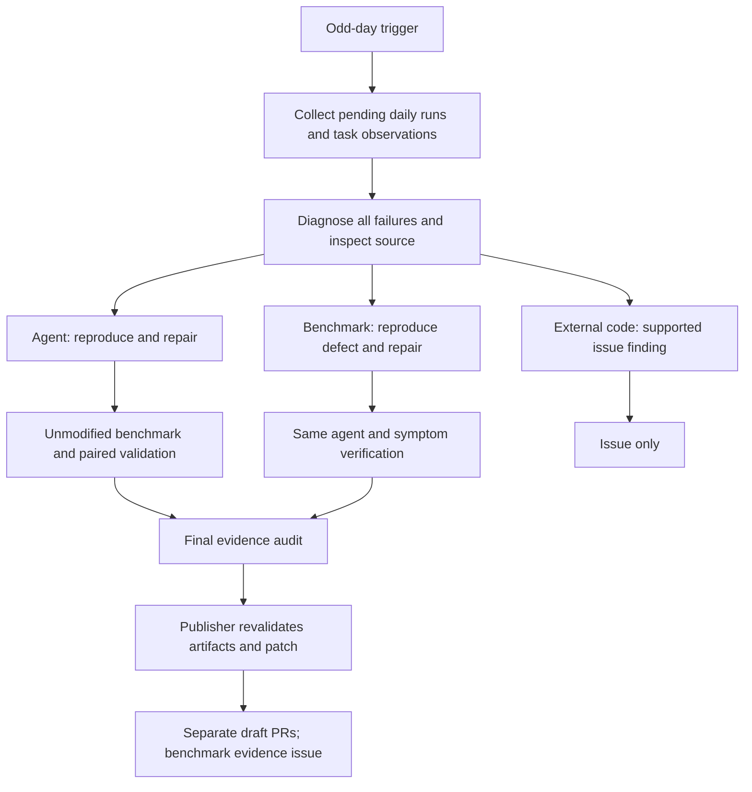
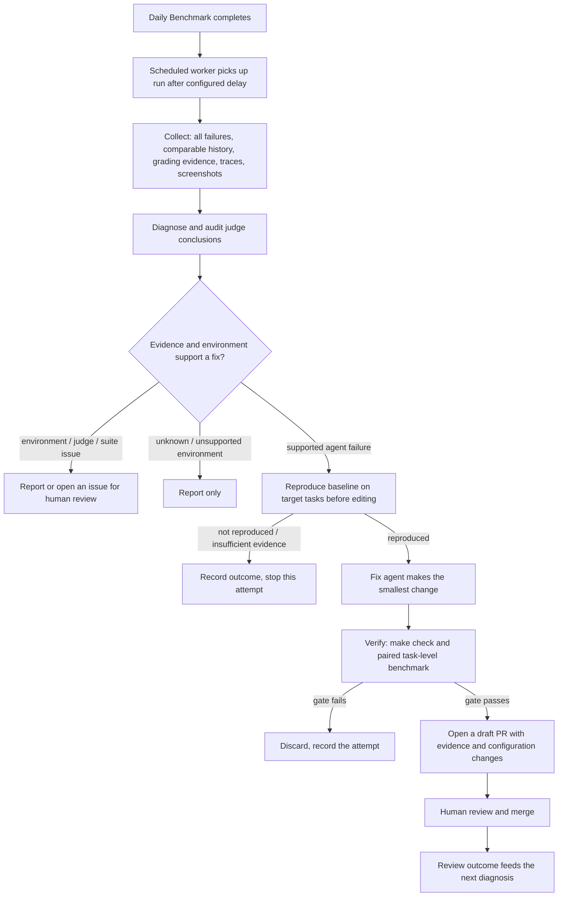

# Benchmark Auto-Improve

> Status: initial implementation, disabled until configured. Deterministic
> policy and orchestration tests exist; live model, Docker, GitHub publication,
> and real-emulator acceptance still require deployment validation. The workflow
> runs the full improve pipeline on enabled scheduled main runs and never auto-merges.

Auto-improve turns the daily benchmark into a closed improvement loop: a
separately scheduled worker consumes completed daily runs, diagnoses their
failures and grading evidence, reproduces the affected tasks, proposes the
smallest fix, and verifies it before opening a draft pull request for human
review. Processing may happen later that day or on a subsequent day. Nothing
merges automatically.

## Window processing and repair domains

The worker is scheduled at 01:37 UTC on odd calendar days (`37 1 */2 * *`).
This reduces workflow invocations; month boundaries can produce consecutive days.
Each invocation analyzes **all pending eligible daily runs**, including one-off
failures, rather than selecting one day's results. Daily benchmark execution stays
unchanged. Every task retains its individual outcomes, source revision, task
snapshot and trace references across the window. Failure frequency counts distinct
source runs; it is not a substitute for fresh baseline reproduction.

Production artifact names encode every included identity, for example
`auto-improve-source-41-1__42-1`. Discovery deduplicates those identities separately,
so a late-finishing older run or an artifact previously missing remains eligible.
The three-hour completion delay and 13-day evidence age bound still apply. The
window accepts at most 13 runs; exceeding its budget blocks instead of silently
dropping evidence. Missing artifacts are reported in `source-window.json`.
Manual `source_run` accepts comma-separated IDs. Branch tests can reuse processed
runs and never publish issues or PRs.

Diagnosis routes supported findings into separate domains:

| Domain | Scope | Acceptance | Publication |
| --- | --- | --- | --- |
| Agent | Existing agent Go implementation and skills, excluding benchmark-mode code | Unmodified benchmark; paired task passes improve with no regression beyond three-repeat variance | Draft agent PR |
| Benchmark | Runner, CI helpers, environment bridges/images, MCU emulator and suite definitions | Same agent/settings; diagnosed symptom occurs in at least 2/3 baseline attempts and 0/3 candidate attempts; regression tasks gain no symptom or unevaluable outcomes. Changes to host-executed code are not run (see below) | Separate draft benchmark PR and evidence issue |
| External code | Hardware services, firmware, apps or other code whose effect cannot be verified here | Supported diagnosis with source/evidence references | Issue only |

At most two repair clusters per domain share the existing five-hour execution
budget. Agent targets affected by a supported benchmark defect are deferred until
evaluation is repaired. All candidates start from the same base revision: an
agent candidate never consumes a benchmark candidate's changes. Neither domain
can edit this pipeline, workflow files, tests, dependencies or vendored content.

Benchmark repairs declare a concrete symptom: setup failure, judge error,
environment failure, matching failed-tool-result text, hard assertion, or metrics
error text. Three fresh baseline attempts must reproduce it before patching. Judge
errors are not rejudged on this track. Baseline and candidate have independent
checkouts and daemon/MobileGym image tags. Checks include `make check` and the
full `benchmark-python` suite; Go edits also require `go-unit`. Checks run in the
pinned test container and receive no model credentials. A `tool_error` symptom
counts only results the runner classifies as failed, and the fix must also reduce
the number of failed tool results, so rewording an error message is not a repair.

Benchmark code splits by where it runs. Suite data, daemon images, the daemon
entrypoint, the MCU emulator, and MobileGym bridge code run only inside disposable
containers; repairs there are executed and verified as described. The runner,
CI helpers, and the ADB, desktop, and vPhone bridges run on the self-hosted runner,
which holds model credentials and the Docker socket. Model-authored changes there
are never executed: after the reproduction audit and checks pass, the candidate is
`proposal_ready` and is published as a draft PR marked "Not executed: human
verification required", listing the host-executed files and the publisher's
recomputed baseline reproduction. The publisher refuses a host-path change that
claims to have been executed.

Changes to code that records the measured fields (`runner/main.py`, `runtask.py`,
`scenario.py`, `trace.py`, `harness.py`), like grading code, are listed as
evaluation-contract changes, because they could hide a symptom without fixing it.

The same agent runs candidate tasks after the repair. Pass rates are reported,
not used as the benchmark acceptance criterion. Final review inspects every task
for errors that could replace the original symptom. The publisher independently
recomputes symptom matches from retained traces and checks result rows against
retained execution output before creating a PR.

Rubric, assertions and expected values are preserved by default. Necessary
changes to those fields, grading code, or task removals are listed explicitly in
the PR with the repair rationale for human judgment. Removing a task is allowed
only for a reproduced target; removing regression coverage blocks the candidate.
A supported scenario-value review is required before a removal can become ready.
No PR is merged automatically. Publication is bounded to two PRs per domain per
invocation; issue markers make retries idempotent.

Only a settled run marks its sources processed. A main run whose final status is
`completed`, `diagnosed`, or `no_failures` uploads `auto-improve-source-<identity>`;
an errored, blocked, interrupted, or cancelled run uploads `auto-improve-retry-<identity>`,
which keeps the same sources eligible for the next run. A cluster whose diagnosis
violates policy (unobserved or ineligible targets, no observable benchmark symptom,
a patch outside its paths) is recorded as `invalid_proposal`. It uses no repair
slot and does not block the run; only execution failures block.



This section describes the current window/domain implementation. The detailed
initial agent design below remains useful for the agent track; its original
agent-only scope and single-source scheduling restrictions are superseded here.
Real runner/model/publication validation of the window and benchmark track is
pending. Local synthetic tests do not establish live acceptance.

## Running the initial implementation

The entry points are
[the workflow](../../.github/workflows/auto-improve.yml),
[the driver](../../benchmark/ci/auto_improve/driver.py), and the separate
[discovery/publisher](../../benchmark/ci/auto_improve/control.py).

Test the implementation on a repository branch before merging it. Keep these
three identities separate:

- **Execution branch:** the version of the driver/agent being tested. Manual
  runs accept `main` or an explicit `auto-improve-test/*` branch.
- **Source benchmark:** a completed scheduled Benchmark run from `main`, even
  during a branch test. A manual source ID cannot bypass this restriction.
- **Publication target:** `main`. Branch tests never publish; on `main`, manual
  publication additionally requires `publish_pr=true`. Scheduled improve runs
  can publish only after the schedule has been explicitly enabled.

GitHub requires a new `workflow_dispatch` workflow to exist on the default
branch before it can be dispatched. To test without merging a registration stub,
this workflow also accepts pushes to two explicit branch prefixes in this
repository (not pull-request events):

| Branch prefix | Behavior on push | PR publication |
| --- | --- | --- |
| `auto-improve-test/diagnose/` | Read main's benchmark evidence and run diagnosis | Never |
| `auto-improve-test/improve/` | Diagnose, reproduce, fix and verify using the branch checkout | Never; keep the patch in the artifact |

Each push to one of those branches is an intentional test and may incur model
and benchmark costs. Ordinary branches and PR events do not trigger this pipeline.
Use `auto-improve-test/diagnose/initial` for diagnosis and
`auto-improve-test/improve/initial` for full-pipeline acceptance. Test branches
never publish PRs, even when reproduction and verification pass.
Test artifacts use `auto-improve-test-source-<run_id>-<attempt>` and do not mark
main's production runs processed. Repeated branch tests may reuse an already
processed source. Production artifacts use `auto-improve-source-...`, or
`auto-improve-retry-...` when the run did not settle.

1. Configure the review model/key/endpoint as described below and push the
   implementation to the diagnosis test branch. Discovery requires an available
   source artifact from a main daily run completed at least three hours ago.
2. Read the Actions summary and `diagnosis.json` in the test artifact. Existing
   main artifacts may lack the new screenshots/`judge.json`; this is an evidence
   limitation, not a reason to merge untested code. Report affected conclusions
   as inconclusive rather than inventing evidence. Old post-run LLM analysis is
   neither enabled nor required.
3. Run `improve` on the corresponding test-branch prefix for end-to-end
   acceptance. A single run executes diagnosis, reproduction, patching, checks,
   and paired verification without opening a PR. Supply Docker and existing
   benchmark credentials; the isolated AVD fixture is needed only for ADB tasks.
4. Merge through normal review after the branch tests are satisfactory. Configure
   PR permission before enabling publication, then test on `main` with an
   explicit source ID, `mode=improve`, and `publish_pr=true`.
5. Enable `AUTO_IMPROVE_ENABLED=true` for odd-day execution (01:37 UTC). Scheduled
   main runs default to `improve`; set `AUTO_IMPROVE_MODE=diagnose` only for an
   explicit read-only run. Nothing in this change enables the schedule,
   alters repository permissions, installs a fixture, or merges automatically.

### Minimal first run

Add the new values under **Settings → Secrets and variables → Actions**:

- Variable `AUTO_IMPROVE_REVIEW_MODEL`: the model ID supported by your chosen
  Claude Code/Anthropic Messages provider.
- Secret `AUTO_IMPROVE_REVIEW_API_KEY`: the provider key; do not paste it into a
  PR, document, or chat.
- Variable `AUTO_IMPROVE_REVIEW_BASE_URL`: set only for a compatible gateway;
  omit it for the direct Anthropic API. An OpenAI-compatible chat-completions
  endpoint alone is insufficient for this harness.

No PR token, emulator fixture, or scheduled-enable variable is needed for
`diagnose`. Before the workflow is registered on the default branch, use the
explicit diagnosis push-test branch described above. Once registered, the UI
branch selector or CLI can execute the test branch directly:

```bash
gh workflow run auto-improve.yml \
  --ref auto-improve-test/diagnose/initial -f mode=diagnose
```

Leave `source_run` empty for discovery, or add `-f source_run=<run-id>` to select
or retry one eligible main daily run. Successful diagnosis produces a summary
and artifact, not a PR. Manual `improve` also defaults to no publication and
needs only benchmark execution prerequisites, not a PR token.

For formal publication after testing and merging:

```bash
gh workflow run auto-improve.yml --ref main \
  -f mode=improve -f source_run=<run-id> -f publish_pr=true
```

An explicit source ID matters when diagnosis has already marked that source
processed. Branch-test candidates retain their execution ref and are rejected
by the publisher even if its command is invoked separately.

### Repository configuration

| Name | Kind | Purpose |
| --- | --- | --- |
| `AUTO_IMPROVE_ENABLED` | Variable | Opt into scheduled execution; default disabled |
| `AUTO_IMPROVE_MODE` | Variable | Scheduled main defaults to `improve`; set `diagnose` to pause fixes and only analyze |
| `AUTO_IMPROVE_REVIEW_MODEL` | Variable | Explicit Claude Code-compatible review model; no implicit judge fallback |
| `AUTO_IMPROVE_REVIEW_BASE_URL` | Variable | Optional Anthropic Messages-compatible endpoint, not an OpenAI chat-completions URL |
| `AUTO_IMPROVE_REVIEW_API_KEY` | Secret | Review-model credential; supplied only to review execution |
| `AUTO_IMPROVE_PR_TOKEN` | Optional secret | Optional repository-scoped bot token. Without it, publication uses the built-in `GITHUB_TOKEN` with contents/pull-requests/issues write access only in the publication job |
| `AUTO_IMPROVE_DELAY_HOURS` | Variable | Minimum age after source completion; default 3 |
| `AUTO_IMPROVE_REVIEW_MAX_TURNS` | Variable | Bounded review turns, default 48, accepted range 8-100; the diagnostic index links to per-task evidence to avoid repeatedly paging a monolithic input |
| `AUTO_IMPROVE_MAX_TASKS` | Variable | Total selected tasks per cluster, default 32; required coverage is deferred rather than truncated |
| `AUTO_IMPROVE_AVD_TEMPLATE` | Variable, ADB only | Runner-side path to the offline initial-state copy used for private emulator instances; not needed for diagnosis or isolated/MobileGym tasks |
| `AUTO_IMPROVE_AVD_SHA256` | Variable, ADB only | Fingerprint of that initial state, preventing an unnoticed fixture change during comparison |
| `BENCHMARK_ANDROID_SDK_DIR` | Variable | Android SDK location; existing benchmark setting, default `~/android-sdk` |

Reuse the existing `BENCHMARK_AGENT_*` and `BENCHMARK_JUDGE_*` variables/secrets
for measured runs. The custom review base URL is passed through as
`ANTHROPIC_BASE_URL`, with the configured key as `ANTHROPIC_API_KEY`; no second
provider configuration is required. Presence of configuration is not evidence
that the endpoint has passed an actual model call.

For publication, an administrator may need to enable **Settings → Actions →
General → Workflow permissions → Allow GitHub Actions to create and approve pull
requests**. The workflow requests write permissions only for its separate
publication job; test and model jobs remain read-only. If organization policy
blocks this, diagnosis and patch verification still work without publication.
PR workflows created with `GITHUB_TOKEN` may require a person with write access
to approve the CI run; follow the PR's banner and required checks.

An optional PAT is created from the account's **Settings → Developer settings →
Personal access tokens → Fine-grained tokens**, not from repository settings.
It cannot grant permissions its owner does not have. Organization approval or a
GitHub App installed by an administrator may be necessary; do not work around
those restrictions with a broader credential. If used, scope it to this repo
with contents/pull-requests/issues write access, store it as
`AUTO_IMPROVE_PR_TOKEN`, and apply branch protections. Create the `auto-improve`
label before publication. Neither credential option is needed for branch tests.

The initial operational bounds are at most two clusters, three attempts per
task/side, 48 turns and 15 minutes per review session, a five-hour driver budget,
and a six-hour job ceiling. There is **no Claude Code model-cost cap**; the CLI's
`total_cost_usd` estimate is recorded for each session and summarized in the
job output/PR. A target baseline is stale when more than one hour passed between
its first target run and the start of candidate verification; a stale baseline
requires a new attempt. These turn/time limits prevent a stuck job; they are not
spend limits. Configure any provider-side financial alerts or quotas separately
if needed.

### Android SDK fixture setup and acceptance

The template is a reusable **initial phone state**, not another agent/model or
a requirement to buy another device. Every ADB attempt starts from a private
copy so one candidate cannot inherit the previous task's app data or mutate the
nightly emulator. The directory path locates it; the checksum identifies the
state. These two settings are provisioned once by the runner operator and are
needed only when testing ADB behavior. Do not stop or export a running nightly
emulator without arranging an idle window with its operator.

The initial emulator backend is Android SDK AVD, not Genymotion. Provision an
**offline copy** with the required apps, permissions, locale, display settings,
and deterministic task data. Include `config.ini` and `userdata-qemu.img`.
Do not point the template at a running AVD. The fixture must have no locks,
symlinks, personal accounts, or backing disks outside the export. If it contains
qcow2 overlays, `qemu-img` must be available; the launcher validates the backing
chain and flattens copied overlays so they cannot reference the nightly disk.
The system image referenced by `image.sysdir.1` must already be installed and
kept fixed on the runner. Companion-app tasks require a rootable image and the
pinned AidenBridge APK preinstalled; the driver does not download a moving APK.

From `benchmark/`, fingerprint the prepared export:

```bash
uv run python -m ci.auto_improve.emulator fingerprint \
  --template /path/to/offline-fixture.avd
```

Set `AUTO_IMPROVE_AVD_SHA256` to that output. Then perform a no-model smoke run:

```bash
uv run python -m ci.auto_improve.emulator smoke \
  --template /path/to/offline-fixture.avd \
  --sha256 "$AUTO_IMPROVE_AVD_SHA256" \
  --out runs/auto-improve-avd-smoke --companion
```

The smoke starts two disposable instances sequentially, writes a marker in the
first, verifies it is absent in the second, checks the companion prerequisites
when requested, and checks that pre-existing connected devices remain. It does
not replace validation of real app-state reset, phone-bridge routing, or forced
cancellation on the deployment runner. Orphan cleanup checks PID start time and
unique AVD identity before terminating a leftover process; uncertainty retains
the ownership record for an operator instead of risking another device.
Work files and ownership records live under the runner tool cache (scoped by
repository and workflow run), so GitHub's temporary-directory cleanup does not
remove a live orphan's record. Successful artifact upload is followed by owned
resource cleanup; interrupted/failed uploads retain work for inspection.

### Initial implementation boundaries

- A review session is restricted, read-only Claude Code with `Read/Grep/Glob`.
  It sees a staged source/evidence tree, not repository credentials, `.git`, shell
  tools, or held-out suites. The fix session returns exact text replacements;
  trusted Python validates and applies them. Diagnosis uses `source_paths` for
  verified existing agent files and `evidence` for trace/screenshot/code references.
  Evidence files are never accepted as modification targets. Missing source
  grounding or required visual evidence prevents automatic repair.
- Writable files include existing Go implementation files under
  `src/agent/internal/` and `src/agent/cmd/`, plus existing
  `src/agent/config/skills/*/SKILL.md`. Go logic, prompts, and tool descriptions
  can change. Tests, test fixtures, vendored code, dependency metadata, benchmark
  evaluators, and workflow/build scripts remain excluded. The exact-replacement
  mechanism currently edits existing files only; adding files is not supported.
- Improve mode checks Bash, Git, GNU make, Docker daemon access, and Docker
  Compose before source discovery or model calls. On apt-based runners it installs
  missing make using root or non-interactive sudo; other runners must provision
  make in advance. Compilers and test dependencies remain in the pinned test image.
- One unmodified baseline checkout is shared by every cluster in a run; each
  cluster gets an isolated candidate checkout. Both clone the workflow checkout,
  including the initialized MobileGym gitlink commit, so they do not download the
  submodule again. Benchmark image construction still verifies the MobileGym image
  label against that pinned commit.
- Code checks retain `check-resources.log`, a bounded CPU, memory, process,
  container, and synchronous-write latency snapshot without command arguments, to
  distinguish runner contention from candidate regressions. Checks set
  `AICO_TEST_TMPFS=1`, so test scratch files and Go test binaries use an in-memory
  directory inside the pinned test container. `AICO_TEST_CACHE_DIR` points every
  candidate checkout at one persistent Go and uv download cache on the runner. Test commands and assertions are
  unchanged; this removes host disk-sync latency from timing-sensitive tests.
- Paired comparison uses three repeats per side, which cannot separate a single
  lost pass from model variance. A task regresses when it loses two or more passes;
  the neighbor and held-out set regresses when its total passes drop by more than
  max(2, 5% of its attempts). Targets must still reach at least 2/3.
- Agent fixes cannot edit benchmark-mode files (any `benchmark*` path under
  `src/agent`) or add references to the benchmark, so a fix cannot special-case
  evaluation.
- Every candidate runs `make check`. Any Go file change also requires
  `bash scripts/run_tests_in_docker.sh --suite go-unit`, because the quick
  profile does not exercise the full Go unit suite. The publisher independently
  checks that the required checks were recorded along with the benchmark results.
  A failed candidate check remains blocking; the same command also runs on the
  unmodified baseline and retains a separate log to diagnose pre-existing failures.
  Baseline success or failure never overrides the failed candidate gate. Checkout
  cleanup makes owner-owned Go module cache directories writable before deletion;
  cleanup errors are recorded separately without replacing the original check error.
- Neighbor coverage includes the target suite's related tasks and any explicitly
  justified neighbors. Up to ten additional same-environment tasks are selected
  deterministically, excluding failures exposed during diagnosis. If independent
  coverage is unavailable or the total exceeds budget, the change is deferred.
  Clusters are screened before they use one of the two repair slots: ADB targets
  need `AUTO_IMPROVE_AVD_TEMPLATE` and `AUTO_IMPROVE_AVD_SHA256`, otherwise the
  cluster is reported as `environment_unavailable`, and plans over the task budget
  are `deferred` without checkout or model calls. Diagnosis receives the runnable
  environments so it can keep repair targets reproducible on the runner.
- Diagnosis lists failures it attributes to the evaluator or environment in
  `evaluation_issues`. The driver removes those tasks from every cluster's repair
  targets and runs them only as regression checks, recorded as
  `quarantined_targets`; a cluster left with no target is `evaluation_issue`.
  The attempt's stored `cluster` is the repaired one (its identity is what the
  publisher recomputes), and `diagnosed_targets` keeps the original list. The
  verification reviewer receives these tasks as `known_evaluation_issues`: the
  known issue alone is not a blocking gap, but worse candidate behavior in their
  traces still is.
  Because quarantined tasks are not targets, they do not pull their suite's
  neighbors into the plan.
- A task attempt whose judge call fails (`judge_error`) is rejudged after 30 and
  then 90 seconds with the same judge model, rubric, trace, and screenshots, using
  the repository's `rejudge_run(only_judge_errors=True)`. The agent is not rerun and
  its execution evidence is unchanged; `results.original.jsonl` keeps the first
  result. Attempts still failing remain `judge_error` and fail the comparison.
  Rejudging happens only after a completed runner invocation; a timed-out or
  cancelled run keeps its evidence, and cancellation during the wait stops the
  driver.
- The verification reviewer receives the exact candidate diff and an
  `evidence-index.json` listing every retained trace, judge result, and history
  file per attempt. The audit is scoped to the claimed fixes and to regressions;
  gaps that could hide a regression or explain a fix remain blocking.
  This is a regression holdback, not a new statistically representative baseline.
- Publication independently recomputes the gate and validates the patch against
  the tested base. If `main` advanced during the run, the publisher three-way
  merges each validated file onto main's current version; when that merges cleanly
  and passes the same content checks, the commit is created on top of the current
  `main` and the PR states which base the checks and paired tasks ran on, so CI
  checks the new base. A conflict, including an edit on an adjacent line, requires
  a fresh run.
- Reports go to the Actions job summary and artifacts. The summary explicitly
  states execution status and validated-candidate count. A checkout/build/task
  execution error marks the run `blocked` and returns a nonzero exit code;
  successful diagnosis alone cannot hide a blocked improve attempt. A blocked
  sibling cluster does not discard a validated one: the driver exports the
  `ready` count, and the publish job runs whenever it is positive and the run was
  not cancelled. The publisher still revalidates every candidate. A completed
  run with no accepted candidate still does not mean that a fix was validated.
  Large checkout operations have a deadline-bounded 15-minute allowance and
  individual retained logs. Environment/evaluator findings remain report-only
  initially; automatic issue creation and Lark delivery are not yet implemented.
- The first implementation uses the existing single self-hosted benchmark runner
  to serialize jobs, plus workflow concurrency to serialize auto-improve. Adding
  multiple runners to that label requires a shared resource/scheduling policy.
- Fourteen-day artifacts and PR markers supply recent history. No SkillOpt,
  separate history branch, or long-term backup service is required.
- Production `improve` completes diagnosis, reproduction, modification, and
  verification in one Actions run. Publication is a separate job within that
  run solely to isolate write credentials; it is not a second user-triggered run.

The sections below retain the design rationale and future extension points.

## Current scope decisions

- Keep source daily runs and PR targets on `main`. Permit explicit repository
  branch tests with no publication. Scheduled execution remains main-only;
  manual source selection cannot bypass the source-branch rule.
- Allow agent Go implementation fixes as well as skill/prompt/tool-description
  changes; preserve the benchmark and existing tests as independent checks.
- Start with a configurable delay of at least three hours after the source
  benchmark completes. Same-day processing is not required.
- Diagnose all available failures. Include `isolated`, `mobilegym`, and
  isolated ADB Android emulator execution in the first implementation. Build
  emulator provisioning/reset/cleanup as part of that scope; do not fall back
  to the shared nightly emulator. Physical and external-device cases remain
  report-only.
- Review the judge's criteria, reasons, and evidence before changing the agent.
  Judge-scored tasks are eligible; suspected grading errors are reported.
- Configuration changes do not pause the workflow. Disclose them in the PR and
  compare baseline and candidate under one explicitly recorded configuration.
- Leave an extension point for SkillOpt; do not integrate it in the first
  implementation. Skill text can use the ordinary fix-and-verify path.
- Keep detailed evidence in 14-day workflow artifacts. Use recent workflow
  records for scheduling and PR/issue summaries for review history. No dedicated
  history branch, independent backup service, or long-term trace archive is
  required for the first implementation.

## Goals and non-goals

Goals:

- Convert daily benchmark failures into reviewed, evidence-backed fixes.
- Reject changes that only reflect run-to-run noise.
- Keep each proposed change small and attributable to one root cause.

Non-goals:

- Changing benchmark suites, assertions, judge configuration, or fixtures to
  raise scores. Evaluator problems become issues for a human.
- Replacing the daily benchmark as the full regression check.
- Auto-merging.

## Flow



There is no separate task-selection stage. Every available failure of the
source run goes to diagnosis. Evidence review and targeted reproduction decide
whether a proposed fix has enough support to proceed. Three repeats provide
initial evidence, not proof that a task is stable or flaky.

## Stages

### 1. Trigger and inputs

- A new `auto-improve.yml` workflow uses an independent schedule and supports
  manual dispatch with a source run ID. It discovers completed scheduled
  `Benchmark` runs on `main` that have not already been processed.
- Start with a configurable minimum delay of three hours measured from source
  run completion, not its scheduled start. A later processing window or a
  subsequent day is allowed. Do not hold a runner in a sleeping job during the
  delay; the next scheduler invocation can claim an eligible run.
- Key processing records by repository, source run ID, and run attempt. Include
  that identity in the auto-improve workflow run name and artifact manifest so
  recent runs can be matched to their source without a history branch. Use a
  single writer or a lock to prevent duplicate claims. Completed source runs
  with partial results can produce diagnostics for the available evidence;
  missing artifacts or incomplete selected-task results cannot count as validation.
- Fetch evidence before its retention expires. If the backlog outlives that
  window, record `evidence_missing` and require a fresh run rather than silently
  treating an old score as reproducible evidence.
- Inputs:
  - the run's uploaded artifact (`benchmark-<run_id>-<attempt>`, retained for
    14 days);
  - history from the seven days preceding the source run, using
    [`fetch_langfuse_history.py`](../../benchmark/ci/fetch_langfuse_history.py),
    with configuration differences identified;
  - task-level failure evidence from
    [`failure_details.py`](../../benchmark/ci/failure_details.py), plus the
    task `history.json`, `trace.json`, and screenshots referenced by each row's
    `artifact_dir`;
  - recent auto-improve artifacts (previous diagnoses and discarded attempts)
    and relevant open/closed PRs and issues for prior review outcomes. Older
    detailed traces are optional, not required inputs.

### 2. Diagnosis (read-only)

Run Claude Code headless with read-only tools (file reads, search, Langfuse
queries). Configure the review model independently of the agent and judge;
prefer a model capable of reading code and visual evidence. Model choice alone
does not establish that its conclusions are correct.

For the run's failures, diagnosis:

1. checks the task goal, rubric, hard/environment assertions, judge verdicts
   and reasons against the actual trace, screenshots, and final state;
2. records a judge review outcome (`supported`, `disputed`, or
   `insufficient_evidence`) with evidence references; a positive result is
   audited as well when it supports a claim that a fix worked;
3. groups failures with the same supported root cause into clusters;
4. uses comparable history to label each cluster as new, persistent, or
   intermittent, recording configuration changes separately;
5. locates the first failing step and assigns a failure category: perception,
   grounding, execution, verification, planning, or recovery;
6. chooses a fix target: `skill`, `prompt`, `tool_description`, `go_code`,
   `benchmark_or_env`, or `unknown`;
7. lists the target task IDs and the neighbor task IDs (see
   [Task selection for reproduction and verification](#task-selection-for-reproduction-and-verification)).

Outputs are `diagnosis.json` for the following steps and a readable report for
the team channel. Judge-scored tasks are not excluded merely because they use
an LLM judge. Disputed verdicts and missing grading evidence must be resolved
before using those tasks to justify a fix. Keep the original scores unchanged;
a diagnosis is not a replacement score. An explicit rejudge can be retained as
separate evidence when useful, with its configuration recorded.

`benchmark_or_env` and `unknown` clusters appear in the report; a later publisher
extension may open issues. ADB emulator cases proceed on newly provisioned isolated instances.
Physical and external-device cases receive diagnosis but no automated execution
in the first implementation. If the required emulator image or host support is
unavailable, report an environment/setup gap; never reuse the shared emulator
or describe an unverified change as a validated fix.

### 3. Reproduce before editing

- Handle at most two clusters per run, ordered by the number of affected tasks.
- Freeze the selected task IDs, evaluation contract, and execution configuration
  before editing. Reproduce only those target tasks on the baseline.
- Review the new results and their grading evidence. Record `not_reproduced`,
  `intermittent`, or `insufficient_evidence` when applicable; do not label an
  entire cluster flaky because one task passed twice.
- Review each task independently against its fresh reproduction evidence. A
  recovered task or a confounded environment failure must not invalidate a
  different, independently reproduced agent failure in the same historical cluster.
  Keep removed targets in neighbor regression coverage and record their individual
  dispositions. The fix proposal receives the supported targets and corrected
  evidence, not stale claims about the removed targets.
- Only reproduced, supported failures proceed to modification. No A/A study or
  change to daily repeats is a prerequisite for starting this workflow.

### 4. Fix

- Use one branch per cluster: `auto-improve/<date>-<cluster>`.
- Agent Go implementation, skill text, prompts, and tool descriptions use the
  same fix agent and verification path. Keep `fix_target` in the diagnosis contract so a later
  adapter can delegate eligible skill changes to
  [SkillOpt](../10-skillopt/README.md). SkillOpt setup is not an initial dependency.
- Claude Code proposes exact replacements within the diagnosed paths; the driver
  applies them only to allowed existing agent Go/skill files. `benchmark/`, judge
  configuration, tests (`*_test.go` included), fixtures, vendored code,
  dependencies, and `.github/` are not writable by the fix agent.

### 5. Targeted verification

Reproduction and verification run selected tasks, not whole suites. The next
daily benchmark supplies broader regression coverage after merge.

| Step | Tasks | Commits | Repeats | Purpose |
| --- | --- | --- | --- | --- |
| Reproduce | Target tasks | Baseline | 3 | Check whether the failure recurs |
| Verify: target | Target tasks | Candidate | 3 | Confirm the fix |
| Verify: neighbors | Neighbor tasks | Baseline and candidate | 3 each | Catch fixing one task by breaking a similar one |
| Verify: held-out | Up to ten deterministic same-environment tasks not exposed in diagnosis/fixing | Baseline and candidate | 3 each | Guard against overfitting to the failures |

Reuse the reproduction results as the target baseline when their task set,
configuration, environment reset, and collection window remain comparable.
If validation happens substantially later or any of those inputs change,
refresh the target baseline. Interleave fresh baseline and candidate runs
where feasible to reduce temporal drift; this cannot eliminate provider or
environment variability. `make check` must pass before candidate benchmark
verification starts. Candidates changing any Go implementation file must also
pass the Docker-backed `go-unit` suite; the publisher verifies that both required
check results accompany the candidate.

Use separate baseline and candidate agent state, memory, and environment
instances, reset to equivalent fixtures for every attempt. Do not silently
remove incomplete or unevaluable attempts from the selected-task comparison.
Audit judge evidence for the apparent fixes and regressions before opening a PR.

A draft PR opens only when all of the following hold:

- at least one target task is fixed, passing at least two of three candidate
  attempts;
- no confirmed regression on neighbor or held-out tasks, and no unresolved
  grading or execution failures in the required validation;
- median tool calls and tokens do not grow by more than 20%.

The two-of-three pass rule and 20% cost bound are provisional screening defaults
for draft PRs, not statistical proof of improvement. Report all per-task counts,
coverage gaps, and uncertain outcomes; absence of required evidence is
inconclusive. Keep the gate policy fixed for each attempt and calibrate it with
observed results rather than allowing the fix agent to choose its own threshold.

### 6. Pull request and feedback

- Open a draft PR labelled `auto-improve` containing the diagnosis, Langfuse
  trace and report links, a paired result table (fixed, broken, cost change),
  the change scope, source run and baseline/candidate commit IDs, and any
  configuration differences between discovery and verification.
- At most two PRs per day. Skip clusters that already have an open
  `auto-improve` PR or issue.
- Save diagnoses and discarded attempts in the auto-improve artifact with
  14-day retention. Read relevant PR review comments and outcomes directly from
  GitHub; the PR body retains a concise diagnosis and verification summary.
- Put a stable failure signature and source-run identity in machine-readable
  PR/issue markers. Before publishing, check recent workflow attempts and both
  open and closed matching PRs/issues, including after a retry or interruption.
  Do not repeat a rejected fix without new evidence; exact signature construction
  is an implementation detail to settle before enabling publication.

## Configuration changes and delayed processing

Model, judge, suite, or environment changes do not automatically pause
improvement. The source run is diagnostic evidence; a fresh reproduction can
establish whether its failure still exists under the configuration chosen for
verification. Record that choice before editing.

For a paired comparison, use the same agent model/settings, judge model and
rubric, suite/fixture versions, platform, and budgets for baseline and candidate.
Only the proposed agent change should differ. Never claim a code improvement by
comparing an old-model baseline with a new-model candidate.

Use historical runs with matching known configuration to support regression
claims. Other runs can supply context but must be marked as non-comparable.
The PR must list source and validation configurations, observed changes, task
pass counts, and any unavailable version information. Record the PR base commit;
if a rebase changes the tested code or validation inputs, refresh the affected
checks before describing that revision as validated.

## Evidence retention and recent history

Fourteen days is sufficient for the initial operating model: diagnose a recent
daily run, consult recent history, and reproduce the issue before modifying code.
The workflow does not need months of raw traces or a separate archival system.

| Record | Storage | Use |
| --- | --- | --- |
| Source results, traces, screenshots, judge evidence | Existing benchmark artifact, 14 days | Diagnose and audit a recent failure |
| Diagnosis, attempt manifest, reproduction/verification results, discarded fixes | Auto-improve artifact, 14 days | Resume recent work and avoid repeating recent failed attempts |
| Source run ID/attempt and processing status | Workflow run identity/status plus artifact manifest | Match work to its source and prevent duplicate processing |
| Root cause, task-level before/after counts, configuration, decision, failure signature | PR/issue body and review discussion | Review and remember accepted/rejected fixes without needing old traces |

Operational rules:

- Normal scheduling discovers only recent source runs with available evidence.
  Check the actual artifact expiry when claiming a run; do not assume that a
  delayed source still has a complete seven-day window of raw history.
  Missing older context reduces the history claim, but need not block diagnosis
  of a source whose own evidence is complete.
- Give each auto-improve run's own diagnostic and validation outputs 14-day
  retention. Do not copy all source artifacts on every iteration merely to
  extend their lifetime. PRs carry the findings and exact evidence identities,
  not only expiring download links.
- An expired or manually deleted artifact is unavailable evidence, not proof
  that the task passed or that a previous repair attempt never happened. For an
  expired source, request a fresh targeted baseline instead of reconstructing
  a diagnosis from scores alone.
- Before publishing, reconcile matching PRs/issues even if an earlier workflow
  failed to upload its artifact. If that lookup fails, defer publication rather
  than risk opening a duplicate. No history-branch recovery procedure is needed.
- A PR can outlive the evidence retention window. Its summary and review remain,
  but if reviewers need the expired raw evidence or the candidate/configuration
  has changed, rerun the affected validation. Do not claim that an expired trace
  remains inspectable.

Long-term raw-evidence retention is a later option only if review turnaround,
audit requirements, or actual investigations demonstrate a need. The intended
tradeoff is that an old discarded attempt without a PR may eventually be
forgotten, and an occasional targeted rerun is cheaper than maintaining a new
long-term storage system for the initial workflow.

## Task selection for reproduction and verification

Neighbor tasks are selected in this order:

1. Tasks in the same suite with the same `category` or overlapping
   `hard_assertions.required_tools` (for example, all `touch_gesture` tasks for
   a grounding failure).
2. When the change touches shared code such as screenshot scaling or coordinate
   conversion, matching tasks from every suite that exercises that code. The
   diagnosis lists them. The driver checks the execution budget before starting;
   if the required coverage does not fit, defer the attempt or report incomplete
   validation rather than silently truncating coverage.

Per cluster, the cost is roughly (target + neighbors + held-out) × 3 repeats ×
2 commits, i.e. tens to low hundreds of attempts.

### Existing support

Task-level runs need no runner changes:

- `python -m runner run` accepts `--task-id` (repeatable), `--task-ids`
  (comma-separated), and `--repeats`
  ([`runner/main.py`](../../benchmark/runner/main.py)).
- CI catalog cases already carry `task_ids`, which
  [`run_case.py`](../../benchmark/ci/run_case.py) passes through as
  `--task-id`; [`plan.py`](../../benchmark/ci/plan.py) validates them against
  the suite. The auto-improve driver can construct a `SuiteCase` from the
  catalog entry with the selected `task_ids` and call `run_case` directly,
  reusing environment setup and cleanup.

### Implemented integration and remaining acceptance

- The new policy module aggregates successes per task across three independent
  runs and rejects missing, duplicate, ineligible, or unmeasured results.
- The driver builds baseline and candidate daemon images separately and supplies
  each side's bundled skills from its own checkout. Both per-cluster image tags
  are removed when the cluster finishes; a failed removal is a warning.
- The new emulator lifecycle wraps the existing serial-addressed ADB bridge.
  Each task/repeat gets a fresh AVD clone, a fresh daemon, and owned cleanup.
- Remaining acceptance work is live model/CI publication and actual Android
  app-state/reset/cancellation validation on the configured runner.

### Environment scope and ADB isolation

The first implementation includes `isolated`, `mobilegym`, and isolated Android
emulator execution through ADB. Physical phones and external-device execution
remain out of scope. The existing
[ADB Android bridge](../../benchmark/adbandroid/README.md) can address separate
serials/ports, but its normal reset only returns Home and dismisses the keyboard;
it does not restore application data.

Use the following lifecycle for ADB reproduction and verification:

1. **Version a clean emulator fixture.** Pin the emulator/system-image versions,
   device/display settings, locale, app versions, permissions, and required test
   data. Prepare a stopped clean template or compatible snapshot; no personal
   accounts or production data. Record its identity in the attempt manifest.
   Confirm the runner's actual emulator backend, installed SDK image, and
   virtualization support before choosing the provisioning commands. Support the
   configured backend first, not every ADB-capable emulator product.
2. **Allocate a private instance.** Create a disposable clone with its own writable
   data/snapshot files, emulator ports/ADB serial, bridge port, and agent runtime
   state. Reuse the bridge's explicit serial support. Never attach auto-improve
   to the retained nightly serial merely because it is available. Do not clone
   a running emulator's mutable disk as the baseline fixture.
3. **Reset for every measured attempt.** Before each task and each repeat, restore
   the private clean state or recreate it from the stopped template, wait for
   boot/ADB/bridge readiness, and run the unchanged task setup. Reset the bridge
   lease and agent memory as well as the Android state. Starting a new suite
   process or returning Home is not sufficient. Reuse a snapshot only after
   validating compatibility with the pinned emulator version and host.
4. **Compare equivalent starting states.** Baseline and candidate use the same
   fixture version but independent mutable instances. Record initial screenshots
   and relevant state assertions. Include the companion-app enabled/disabled
   cases with their required setup and network forwarding on the owned serial.
   External network dependencies remain a source of variability; local reset
   does not isolate a remote service.
5. **Clean up only owned resources.** Keep run-scoped process, serial, port, and
   data-directory ownership records. Stop the bridge/emulator and remove only
   disposable resources created by that run on success, failure, or cancellation.
   Recover abandoned instances using those records. Never use a global ADB-server
   shutdown, broad process kill, or wipe/reset of an existing user/nightly device.

Isolation does not require parallel execution. Start with one owned emulator
attempt at a time, resetting/recreating it between attempts to limit RAM/CPU
pressure. Baseline and candidate may run sequentially without sharing mutable
state. Pooling or higher concurrency is a later optimization.

Acceptance evidence for this integration must include: a task that modifies app
state followed by a clean next attempt; baseline/candidate reset equivalence;
correct companion-app variant setup; and timeout/cancellation cleanup that does
not affect an unrelated connected device. These checks require an actual
supported emulator on the runner. If provisioning or readiness fails, record a
setup failure and stop that validation path, rather than using the shared device
or treating the failure as agent quality. These are implementation requirements,
not capabilities already verified by this design document.

## Guardrails

| Risk | Mitigation |
| --- | --- |
| Fixing noise | Reproduce before fixing; paired repeats=3 verification |
| Gaming the benchmark | Exact text replacements and independent publisher validation; evaluator issues are report-only |
| Fixing one task, breaking another | Neighbor and held-out verification |
| Optimizing for the judge | Audit rubric, reasons, and actual outcome before editing and after verification; preserve original scores |
| Stuck execution | At most two clusters per run; finite turn/time limits, with spend reported but no monetary cap |
| Excess permissions | Keep publication credentials outside the agent; use repository permissions plus branch rules and a separate diff-checked publication step |

## Engineering prerequisites

- `auto-improve.yml` and drivers for diagnosis, fix, and verification under
  `benchmark/ci/`.
- Repository secret for the review/fix model API key. Formal publication needs
  repository/organization permission for the built-in token to create PRs, or an
  optional approved bot credential. Neither is required for a branch test.
  The benchmark and auto-improve execution jobs retain read-only permissions.
- Runner scheduling: run auto-improve in a later configurable window, initially
  at least three hours after source completion, with later-day processing
  allowed. Queue execution behind benchmark jobs and avoid overlapping users of
  the same device/environment. A shared runner lock or concurrency policy must
  queue work without cancelling an active benchmark. Waiting jobs must not hold
  a runner in a sleep loop. Extra runners are optional capacity, not a prerequisite.
- Per-attempt time and task bounds. When an execution bound is exhausted,
  persist an incomplete/deferred outcome and release the runner; do not publish
  a PR claiming successful validation. A later attempt can refresh stale baselines.
- Fourteen-day auto-improve artifacts and PR/issue summary markers, with source
  run identity and retry/deduplication handling. No history branch or separate
  backup service is required.
- A pinned clean Android emulator fixture and a runner capable of launching it.
  Implement and validate the isolated ADB lifecycle in the same initial delivery.
- Deterministic holdback coverage from existing suites; a future phone UI
  baseline should be selected deliberately rather than treated as interchangeable
  with a statistical holdout.

## Rollout

1. Complete branch-based integration acceptance, including judge-evidence review.
   Diagnosis-only mode is a troubleshooting option, not the production default.
2. In the initial delivery, add and validate the isolated ADB emulator lifecycle
   alongside `isolated` and `mobilegym` execution. Enable targeted reproduction,
   agent Go/skill/prompt/tool-description fixes, verification, and draft PRs using
   the same fix-agent path, without SkillOpt. Go changes run the full `go-unit`
   suite in addition to quick checks.
3. Optionally add SkillOpt once it has a concrete use case and validation coverage.

## Open decisions

- Verify the configured review model and endpoint's structured output support
  under production load. Record model spend without a workflow-imposed cost cap.
- Whether to add Lark delivery or automatic issues beyond Actions summaries.
- Reviewers for `auto-improve` PRs (CODEOWNERS).
- Calibrate the initial schedule/budgets and conservative signature (target
  identities, affected paths, category) for matching attempts to PRs/issues.
- The runner's emulator backend, pinned image/app fixture, and resource limits;
  verify provisioning, per-attempt reset, and cleanup on that backend.
- Concrete neighbor/held-out coverage and calibration of the provisional PR
  screening thresholds. Keep held-out inputs out of the fix agent's context.
- Whether the daily run moves to repeats=3, which makes the history signal
  stronger but roughly triples nightly runtime.

## References

- [How Warp builds self-improving agents on Claude](https://claude.com/resources/articles/how-warp-builds-self-improving-agents-on-claude)
- [Building agents: When to fold subagents into your main agent loop](https://claude.com/resources/articles/building-agents-when-to-fold-subagents-into-your-main-agent-loop)
- [Agent observability on the Claude Platform](https://claude.com/resources/articles/agent-observability-on-the-claude-platform)
- [Improving skill-creator: Test, measure, and refine Agent Skills](https://claude.com/resources/articles/improving-skill-creator-test-measure-and-refine-agent-skills)
- [Benchmark Metrics Reference](./metrics-reference.md)
