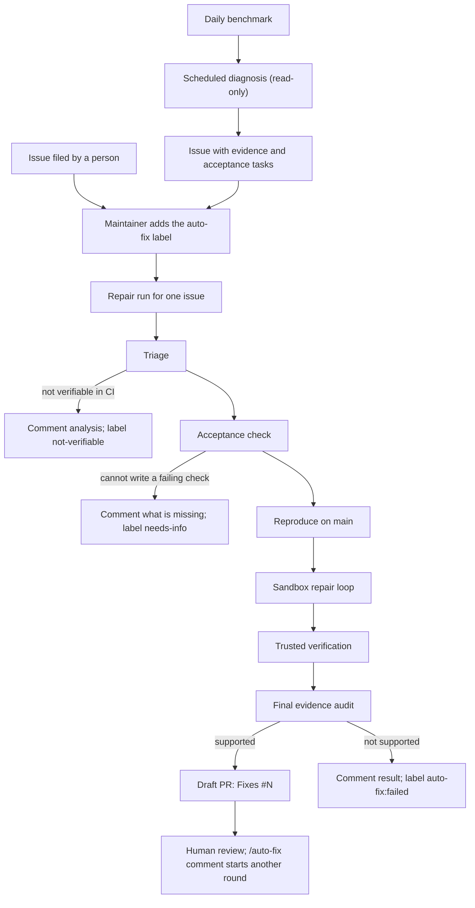

# Issue-Driven Auto-Fix Design

> Status: proposal for discussion. Nothing in this document is implemented. It
> builds on the current [Benchmark Auto-Improve](./auto-improve.md) pipeline and
> reuses its verification gates.

Auto-improve currently diagnoses daily benchmark failures and repairs them in
the same run. This proposal splits the pipeline at an issue. Diagnosis files
issues with evidence, people can file issues too, and a maintainer label starts
a repair run for one issue. The repair step moves into a disposable sandbox
where the model can edit and run tests, while acceptance stays with trusted code
outside the sandbox.

## Motivation

Test runs of the current pipeline show where it works and where it does not.

- **Verification is sound.** Reproduction before editing, paired baseline and
  candidate runs, held-out tasks, publisher recomputation, and draft-only PRs
  decide reliably whether a change helps. This design keeps all of it.
- **Fix generation is the bottleneck.** The fix model reads code and returns
  exact `old`/`new` replacements without running anything. It cannot check its
  own hypothesis, and a failed fix ends the attempt; the next try is the next
  scheduled run. Three consecutive test runs selected the same memory-admission
  cluster, and each patch left both targets failing on every attempt, because
  whether prompt guidance changes a given model's behavior is hard to predict
  without trying it.
- **Each try is expensive.** One attempt costs a full pipeline run of 30 to 80
  minutes, most of it spent re-verifying a patch that a quick local test could
  have rejected.
- **Discovery and repair are coupled.** The pipeline repairs whatever diagnosis
  finds, at most two clusters per domain. People cannot choose what to fix, and
  bugs reported by people cannot use the same repair and verification path.
- **Diagnosis is already the most useful output.** Most findings so far are
  evaluation and environment defects (a missing MCU socket, judge errors,
  dashboard-only daily artifacts) rather than agent behavior.

## Goals and non-goals

Goals:

- One repair path for issues found by the benchmark and issues filed by people.
- Maintainers decide which issues are repaired.
- The repair model can edit, build and test in a loop before handing over a
  candidate.
- Acceptance is decided only by code the model cannot change, as today.
- No credential or Docker access is reachable from model-executed code.

Non-goals:

- Automatic merging. Every change remains a draft PR for human review.
- Repairing hardware, firmware or device behavior that CI cannot verify.
- Replacing the daily benchmark as the broad regression check after merge.

## Overview

## Part 1: Discovery creates issues

The scheduled workflow keeps its current discovery, window and diagnosis
stages, and stops after diagnosis. Each supported cluster becomes an issue.

- The issue body carries the cause, cited trace and code evidence, affected task
  keys, candidate source paths, the repair domain, and the acceptance tasks that
  must change from failing to passing.
- A hidden signature marker, as used by `control.publish_issue` for external
  code today, makes filing idempotent. A later window with the same signature
  appends its new observations to the existing issue instead of opening another.
- Evaluation and environment findings get their own issues in the benchmark
  domain. Hardware and device findings stay issue-only.
- Labels identify the source and domain, for example `auto-improve`,
  `domain:agent` and `domain:benchmark`.

## Part 2: The maintainer gate

A repair run starts only when a maintainer adds the `auto-fix` label to an issue.

- Only users with write access can add labels. Issues in this public repository
  are untrusted input, so filing an issue alone never spends runner time or model
  budget and cannot steer the pipeline into editing code.
- The workflow verifies that the actor who added the label has write permission
  before doing anything else.
- Automatic labeling for high-confidence benchmark issues can be considered after
  the pipeline has a track record. It is not part of the first version.

Issue state is shown with labels:

| Label | Meaning |
| --- | --- |
| `auto-fix` | Maintainer requested a repair |
| `auto-fix:running` | A repair run is in progress |
| `auto-fix:pr-open` | A draft PR is open for review |
| `needs-info` | No failing acceptance check could be established |
| `not-verifiable` | The fix cannot be verified in CI |
| `auto-fix:failed` | Verification rejected the candidate; the comment explains why |

## Part 3: The repair run

One workflow run handles one issue. Runs for different issues are serialized on
the self-hosted runner, as auto-improve runs are today.

| Step | Performed by | Description |
| --- | --- | --- |
| 1. Triage | Model, read-only | Decide whether the issue concerns code CI can verify (agent Go code and skills, benchmark code, web and scripts). Otherwise comment an analysis and stop with `not-verifiable`. |
| 2. Acceptance check | Depends on source | Benchmark issues use their recorded acceptance tasks. For issues filed by people, the model writes a reproduction test in the sandbox: a Go or Python unit test, or a new benchmark task. If it cannot, comment what information is missing and stop with `needs-info`. |
| 3. Reproduce | Driver | Confirm the check fails on current `main`: benchmark tasks fail at least 2/3, and a test fails consistently. Otherwise comment and stop. |
| 4. Repair | Model, in the sandbox | Edit the code, run the reproduction check, unit tests and `make check`, and iterate until they pass or the budget ends. |
| 5. Verify | Driver, trusted | Rerun the reproduction check on base (must fail) and candidate (must pass) in fresh containers, run `make check` and the required suites, and validate the edit scope. Changes to agent behavior also pass the benchmark gate. |
| 6. Final audit | Model, read-only | Audit the diff against all retained evidence, as the current verification review does. |
| 7. Publish | Publisher job | Open a draft PR with `Fixes #N`, the reproduction check and the evidence, and report the outcome on the issue. |
| 8. Feedback | People | A maintainer comments `/auto-fix` with review notes on the PR to start another round, up to three. Merging stays manual. |

The benchmark gate in step 5 is the current one: targets run three times per
side and must reach at least 2/3, regression tasks are screened once per side
and rerun to three only when they look worse, and the publisher recomputes the
result before it creates a PR.

A reproduction test that the model wrote in step 2 is new code, so its own
correctness matters. It must fail on base for the reason the issue describes;
the final audit checks that, and the PR lists the test separately so reviewers
judge it on its own.

## The sandbox

Today the fix model runs as a process on the runner host with only `Read`,
`Grep` and `Glob`. Safety comes from withholding capabilities, which is also why
it cannot test anything. The sandbox inverts this: the model gets edit and shell
tools inside an isolated container that holds nothing worth taking.

- **Image.** The existing test image (`docker/test/Dockerfile`) already provides
  Go, Python, uv and Node, and adds a pinned Claude Code CLI.
- **Mounts.** Only the candidate checkout and the shared Go and uv caches.
  The container runs as a non-root user, like `run_tests_in_docker.sh`.
- **No Docker.** The Docker socket is never mounted. The model cannot start the
  daemon or environment containers, so it cannot run benchmark tasks. That is
  intended: benchmark results must come from code the model cannot change.
- **No credentials.** The container receives no benchmark, judge, GitHub or
  review keys. A forwarding proxy outside the container holds the review key and
  injects it into model API requests; the CLI inside sees only the proxy URL.
- **Restricted network.** The container is attached to an internal Docker
  network whose only reachable endpoint is the proxy, so it cannot send
  repository contents or anything else elsewhere.
- **Limits.** Bounded turns and wall-clock time per session, for example 60 turns
  and 20 minutes, and recorded cost.

Why the key must stay outside: GitHub secrets protect a key at rest and in logs,
but a program that uses the key needs it in plain text at run time. With a shell,
a model could print its environment, and with network access it could send the
key anywhere. Untrusted text in traces, screenshots and repository files can
carry instructions that try to make it do so. Keeping the key in the proxy and
blocking other egress leaves nothing to leak.

After the session, the driver takes the change from `git diff` in the candidate
checkout and validates the final diff rather than individual edits. Everything
the sandbox reports about its own test results is advisory; acceptance comes
only from step 5.

The sandbox also lets benchmark repairs that touch host-executed code, such as
the runner, iterate on unit tests. Running those changes end to end still needs
Docker on the host, so they remain proposals for human verification as today.

## What changes and what is reused

| Area | Today | With this design |
| --- | --- | --- |
| What is repaired | Whatever diagnosis finds, at most two clusters per domain | Issues a maintainer labels, one per run |
| Sources | Daily benchmark only | Daily benchmark and issues filed by people |
| Fix generation | One read-only proposal, no execution | Iterative edits and tests in a sandbox |
| Acceptance check | Benchmark tasks | Benchmark tasks or a reproduction test |
| After a failed attempt | Wait for the next scheduled run | Result recorded on the issue; retry after new information or review |
| Verification and publication | Driver gates and publisher recomputation | Unchanged |

Reused largely as is: discovery and window aggregation, diagnosis, signature
deduplication and issue publication, reproduction, the benchmark gate, the final
audit, the publisher, artifact retention and cost reporting.

New: the label-triggered workflow and permission check, issue state reporting,
the reproduction-test step for issues filed by people, the sandbox image and
launcher, and the key proxy with an internal network.

## Rollout

1. **Issues from diagnosis.** Stop the scheduled run after diagnosis and file or
   update one issue per cluster. Small change; makes findings visible to the team
   immediately.
2. **Label-triggered repair for benchmark issues.** Add the `auto-fix` workflow
   and state labels, reusing the current reproduction, fix, verification and
   publication code with the issue as input.
3. **Sandbox repair.** Replace the read-only fix session with the sandbox, the
   key proxy and the internal network. Measure the fraction of runs that reach a
   verified candidate before and after.
4. **Issues filed by people.** Add triage and the reproduction-test step for
   issues without benchmark acceptance tasks.

## Open questions

- Which code areas are eligible in the first version? A conservative start is
  agent Go code and skills plus benchmark code.
- Should high-confidence benchmark issues ever be labeled automatically, and
  under what evidence threshold?
- How many repair rounds per issue, and what total model budget per round?
- Should the forwarding proxy run as a sidecar per session or as a long-lived
  service on the runner?
- Can repairs for issues without benchmark acceptance tasks run on GitHub-hosted
  runners to keep them off the self-hosted machine? An existing integration such
  as the Claude Code GitHub Action could serve that path before a custom one.
